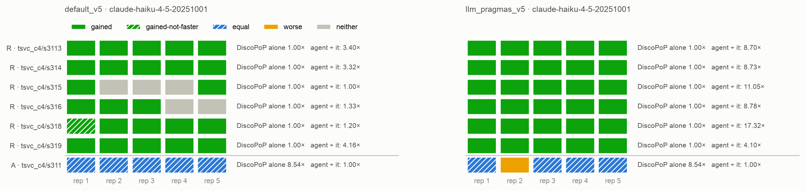
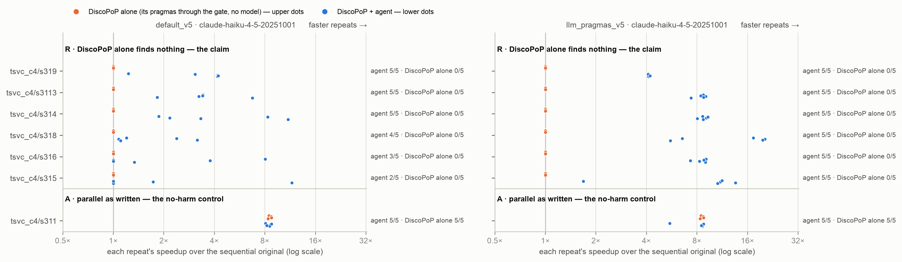

# E3b — the contrast set: who writes the pragma, on loops DiscoPoP does not recognise as written

*Generated by `agent/tools/campaign.py reports` from `results/campaign.json` and the experiment record (`agent/THESIS_EXPERIMENTS.md`). Edit those, then regenerate — not this file.*

**Status:** done

## The question

On six loops that DiscoPoP alone leaves unchanged and whose reference is one or a few directives away — chosen where a difference between the two setups is expected — does the agent ship more race-free verified faster programs where the model writes the pragma than where DiscoPoP writes it, and does anything wrong get through? One control loop DiscoPoP parallelizes itself. (RQ5; reported beside E3, not instead of it)

## Result in one paragraph

Read out 10 Oct (140 trials, 105 with model calls, no failed model call; every changed program of the agent race-clean). On the six loops under test the agent is race-free FASTER in 30 of 30 trials where the model writes the pragma and in 24 of 30 where DiscoPoP writes it — supported as a single test (exact one-sided p 0.0093, CMH 0.0135; three loops differ: `s315`, `s316`, `s318`), not established within the campaign's family (bound 0.49 from the exact p, 0.715 from the CMH p). Neither setup ships an unusable program in 35 trials; Haiku alone 27 of 30 with 3 unusable; DiscoPoP alone 0 of 30; the control 5 of 5 everywhere. What the count does not show: where DiscoPoP writes, the model mostly finds a form DiscoPoP recognises (`x = fmax(x, a[i])`, on which DiscoPoP itself writes `reduction(max:x)`, or an array filled in parallel and reduced afterwards) — with 179 model calls against 52, $29.59 against $6.03, and on four of the six loops less than half the speed (medians 3.32× against 8.73× on `s314`, 1.79× against 17.32× on `s318`). TO READ WITH IT: the premise the set was chosen on — that DiscoPoP has no pragma for a maximum — was wrong (it writes one on the `fmax` form; it does not recognise the loop as TSVC writes it; title corrected, the pre-registration in the record is not); a DiscoPoP defect found in these trials (B23: a minimum reported as a maximum, not repaired) fired in four of the five trials on `s316`, was refused by the gate each time, and can have cost at most one trial; the data hold no two equal largest values, so the position a program returns on a tie is not tested. Cost $38.11 (estimated $84). CORRECTED 11 Oct (`analysis/corrected/`): DiscoPoP B23 repaired on 10 Oct (the author: "Ok"; group B23) and `s316` run again in both setups and DiscoPoP alone on the repaired DiscoPoP (`e3bc_s316`, race check `e3bc_race_check`: every changed program clean) — where DiscoPoP writes, 4 of 5 (was 3), twice with DiscoPoP's own `reduction(min:x)` at the first model call, at 4.2 model calls a trial (was 9.2); where the model writes, 5 of 5 as before. The six loops: the model writes 30 of 30, DiscoPoP writes 25 of 30; exact one-sided p 0.0208 (CMH 0.0273) — supported as a single test, not within the family, as registered; no unusable program in either setup. The corrected table holds trials on two DiscoPoP versions (`s316` on the repaired one; on the other loops the repair changes nothing). $4.80.

## Figures

## What is in this folder

- [`analysis/`](analysis/) — the read-out: [`corrected/discopop_writes/figures.md`](analysis/corrected/discopop_writes/figures.md), [`corrected/discopop_writes/main_comparison_stats.md`](analysis/corrected/discopop_writes/main_comparison_stats.md), [`corrected/discopop_writes/vs_discopop_alone.md`](analysis/corrected/discopop_writes/vs_discopop_alone.md), [`corrected/e3b_tests.md`](analysis/corrected/e3b_tests.md), [`corrected/figures.md`](analysis/corrected/figures.md), [`corrected/main_comparison_stats.md`](analysis/corrected/main_comparison_stats.md), [`corrected/model_writes/figures.md`](analysis/corrected/model_writes/figures.md), [`corrected/model_writes/main_comparison_stats.md`](analysis/corrected/model_writes/main_comparison_stats.md), [`corrected/model_writes/vs_discopop_alone.md`](analysis/corrected/model_writes/vs_discopop_alone.md), [`corrected/vs_discopop_alone.md`](analysis/corrected/vs_discopop_alone.md), [`discopop_writes/figures.md`](analysis/discopop_writes/figures.md), [`discopop_writes/main_comparison_stats.md`](analysis/discopop_writes/main_comparison_stats.md), [`discopop_writes/vs_discopop_alone.md`](analysis/discopop_writes/vs_discopop_alone.md), [`e3b_descriptive.md`](analysis/e3b_descriptive.md), [`e3b_tests.md`](analysis/e3b_tests.md), [`figures.md`](analysis/figures.md), [`main_comparison_stats.md`](analysis/main_comparison_stats.md), [`model_writes/figures.md`](analysis/model_writes/figures.md), [`model_writes/main_comparison_stats.md`](analysis/model_writes/main_comparison_stats.md), [`model_writes/vs_discopop_alone.md`](analysis/model_writes/vs_discopop_alone.md), [`repetition_loop.md`](analysis/repetition_loop.md), [`vs_discopop_alone.md`](analysis/vs_discopop_alone.md)
- [`runs/`](runs/) — 6 archived run(s): the evidence
- [`checks/`](checks/) — 2 verification(s) made during the read-out
- [`preflight/`](preflight/) — 1 smoke run(s) before the launch

## Runs

| run | where | what it is | status | trials | outcomes |
|---|---|---|---|---:|---|
| `e3b_smoke` | [`preflight/e3b_smoke/`](preflight/e3b_smoke/) | E3b smoke, never counted: `tsvc_c4/s314` × 1 — `default_v5` (DiscoPoP writes the pragma), `llm_pragmas_v5` (the model writes it) and `discopop_gate_v5` (DiscoPoP alone, no model), Haiku: the first model call on a package of the new suite, checked before the 140 counted trials start | valid | 3 | FASTER 1, no-change 2 |
| `e3b_1` | [`runs/e3b_1/`](runs/e3b_1/) | E3b, × 5, Haiku: `tsvc_c4` s314 s316 — `default_v5` (DiscoPoP writes the pragma), `llm_pragmas_v5` (the model writes it) and `discopop_gate_v5` (DiscoPoP alone, no model) | valid | 30 | FASTER 18, no-change 12 |
| `e3b_2` | [`runs/e3b_2/`](runs/e3b_2/) | E3b, × 5, Haiku: `tsvc_c4` s3113 s319 — `default_v5` (DiscoPoP writes the pragma), `llm_pragmas_v5` (the model writes it) and `discopop_gate_v5` (DiscoPoP alone, no model) | valid | 30 | FASTER 20, no-change 10 |
| `e3b_3` | [`runs/e3b_3/`](runs/e3b_3/) | E3b, × 5, Haiku: `tsvc_c4` s315 and the control s311 — `default_v5` (DiscoPoP writes the pragma), `llm_pragmas_v5` (the model writes it) and `discopop_gate_v5` (DiscoPoP alone, no model) | valid | 30 | FASTER 22, no-change 8 |
| `e3b_4` | [`runs/e3b_4/`](runs/e3b_4/) | E3b, × 5, Haiku: `tsvc_c4` s318 — `default_v5` (DiscoPoP writes the pragma), `llm_pragmas_v5` (the model writes it) and `discopop_gate_v5` (DiscoPoP alone, no model) | valid | 15 | FASTER 9, no-change 5, parallel-not-faster 1 |
| `e3b_bare_haiku` | [`runs/e3b_bare_haiku/`](runs/e3b_bare_haiku/) | E3b, Haiku alone: `bare_llm_v4` on the seven loops of the contrast set × 5 (`tsvc_c4` s314 s316 s3113 s315 s318 s319 s311) | valid | 35 | BROKEN 2, FASTER 33 |
| `e3b_race_check` | [`checks/e3b_race_check/`](checks/e3b_race_check/) | race_check.py (server, no model) over every changed program of E3b's two setups and of Haiku alone — the gate's ThreadSanitizer build and schedule matrix on each finished file | valid | 0 |  |
| `e3bc_s316` | [`runs/e3bc_s316/`](runs/e3bc_s316/) | E3b corrected for DiscoPoP B23 (a minimum reported as a maximum, repaired 10 Oct): `tsvc_c4/s316` × 5, Haiku — `default_v5` (DiscoPoP writes the pragma), `llm_pragmas_v5` (the model writes it) and `discopop_gate_v5` (DiscoPoP alone, no model), as `e3b_1`, on the repaired DiscoPoP; replaces the `tsvc_c4/s316` cells of `e3b_1` in the corrected read-out. Launched only after the regression of group B23 is read | valid | 15 | FASTER 9, no-change 6 |
| `e3bc_race_check` | [`checks/e3bc_race_check/`](checks/e3bc_race_check/) | race_check.py (server, no model) over the changed programs of `e3bc_s316` | valid | 0 |  |

## Change-log rows that name these runs (§6)

| Date | Repo | Change | Why |
|---|---|---|---|
| 2026-10-13 | result | **E4, step 2 read out (`e4_report_a`, 136 model calls, $8.53): the model's report gives back 20 of the 22 wins the fast refresh loses — every one of the 20 reductions — and removes both keeps the full profile does not make; but it changes 11 of the 58 rewrites the fast refresh had right, which is about 100 of the 541 such rewrites. On the whole population the report as built does not reduce the decisions that differ from a full re-profile. In all of the damaged rewrites the model had called the loop independent: the agent's placing of a reported dependence cannot say which loop it belongs to. The deletion changed no decision on its 21 rewrites.** **Runs.** The smoke `e4_report_smoke` (valid, never counted): 12 Oct 21:59 to 22:03 UTC, two rewrites of `e3bc_s316`, two report calls ($0.059 and $0.075; 78 s and 101 s, about ten thousand thinking tokens each), nothing for the deletion to ask; the launcher's auth line, both replies read by the agent's parser, the sweep clean. `e4_report_a` (valid): 12 Oct 22:04 to 23:17 UTC after PARITY OK at `501a738c9`, the DiscoPoP pass `b22cb05f336e`, four jobs through `server.sh tool` (ended 22:37, 22:54, 22:54, 23:17), every sweep clean; 134 rewrites; no model call failed. Read-out: `results/E04_fast_refresh/analysis/e4_report_readout.md`. **Calls and cost:** 116 for the report ($8.10, median $0.066) and 20 for the deletion ($0.43, median $0.016) — $8.53, against the ceiling of $13.70 put to the author; per call $0.007 to $0.158, 7 to 200 s (median 79 s; the median reply spends about 10,300 tokens thinking). Not in those numbers: the smoke's two calls ($0.13) and one auth-check call per job, five in all, which the tool does not see. **Deviations.** (1) 136 calls, not 137: on one of the 21 rewrites of the deletion (`s331`, repeat 2 of `e3_r_4`, rewrite 1) the review had nothing to ask in this pass — DiscoPoP recorded four static blockers after the fast refresh in the dry pass and none now, while the decision after the fast refresh and after the full re-profile is step 1's on all 134 rewrites. What DiscoPoP records as blockers varies between two passes over one program; the decisions did not. (2) 'About half an hour' was wrong: 73 minutes, a call takes 80 s. (3) Additions to the read-out made while the run was going, after a look at its first 29 records, each marked there and below: the bound from below, the split by kind, the balance of wins, the reading of what stands behind the broken rewrites. The registered units and counts come first. **This pass against step 1:** the fast refresh's decision and the full re-profile's are step 1's on 134 of 134. **A control the tool made possible:** 29 answers left the profile as the fast refresh made it (no row placed, nothing removed); judged again on that same profile, the decision differs in none — what follows is the answers' doing, not the checks' own variation. **(1) The report on the 58 rewrites whose decision differs after the fast refresh.** Repaired — the decision with the report is the full re-profile's — 28. Of the 22 kept only after the full re-profile: 20 kept again with the full profile's directives (`s316` 9 of 9, `s3113` 4 of 4, `s314` 3 of 3, `s319` 3 of 3, `s318` 1 of 1 — the 20 reductions), 2 not (`s293` and `s331`, the two that were no reductions). Of the 2 kept only after the fast refresh: both reverted with the report, as after the full re-profile — on `s318` the model names the dependence on `index` that the data cannot show. Of the 34 kept after both with other directives: 6 repaired, 27 still with other directives, 1 lost with the report (`s316`, repeat 2 of `e3b_1`, rewrite 10). With directives that differ only in a `shared` clause taken as the same: 52 of 58 equal the full re-profile. **(2) The report on the 58 drawn from the 541 whose decision is the same.** The 14 reverted after both: all unchanged. The 44 kept after both with the same directives: 33 unchanged, **11 broken** — 4 lose the win (kept only after the full re-profile: `s212` twice, `s241`, `s314`) and 7 are kept with other directives (in five a `shared(p)` that becomes `firstprivate(p)`, in `s252` and `s281` one of two kept loops gone; the loops that remain passed the gate; whether a program with `firstprivate` in place of `shared` differs depends on what the variable is — not resolved here, and no further normalisation is applied). For the 541: each loop's broken share times its number of such rewrites gives 101.9; the exact one-sided 95 % bound on the broken share is 29.4 %, 159 rewrites. **(3) Keeps the full re-profile does not make:** 2 after the fast refresh alone, 0 with the report; the report produced none. **(4) What the 116 replies held:** none empty, none the agent's parser read nothing from; 456 dependences claimed, 347 placed as rows (in 104 replies), 108 left out by design (on lines the rewrite did not touch), 1 not placeable (a variable the build does not know); 142 loops declared independent, 86 of them loops on which static analysis records a dependence; the explorer never failed after a merge. **(5) The deletion on its 21 rewrites.** A request on 20; 41 blockers asked about: 16 called real, 19 called spurious, 6 not answered (kept as real). All 19 are on four rewrites of `s315`; the review removed dependence lines in three of them (2, 1 and 3 lines) and matched none in the fourth. **No decision changed on any of the 21** (16 reverted after both, 5 kept after both with the same directives, as before); DiscoPoP offers no directive after a deletion that it did not offer before. Read in the code, the model's reasons on `s315` are right — 'x is only read, never written in this loop', 'chksum is not accessed within the loop' — so these were deletions of blockers that static analysis over-reports, and the loop they stood on kept its other blockers. **H7, read as registered** ('refuted on this set if nothing is repaired, or if the report produces keeps the full profile does not make where the fast refresh alone had none'): **not refuted on this set** — 28 of 58 repaired, 20 of the 22 lost wins back, no such keep produced and the fast refresh's own two removed. **And the balance, which the pre-registration said this set could not bound from above:** 11 broken of 58 puts the broken among the 541 at about 102, and — not registered, added during the run — at 60 at least by the one-sided 95 % bound from below (11.0 %). 60 is more than the 28 repaired: **on the population the report as built makes more decisions differ from the full re-profile than the fast refresh alone does; 'the report reduces the decisions that differ' fails there.** By kind (not registered): other directives 7 of 58, about 63 of the 541 (31 to 116 by the two one-sided bounds); wins lost 4 of 58, about 38 (13 to 82). **The balance of wins** (not registered): 22 lost of 599 after the fast refresh alone; with the report 2 of those stay lost, 1 more among the rewrites that had differed only in directives, and about 38 (13 to 82) among the 541 — more wins lost than the 20 regained, most likely; not certainly, since the lower bound is under 20. No p-value and no new member of the family, as registered. **H7b, read as registered** ('refuted if deletion produces no more unsafe decisions than addition'): **refuted** — 0 on the 21 for the deletion, 0 on the 116 for the report. The structural reason, from the dry pass: the fast refresh leaves no static blocker on the loops that matter (21 of 599 rewrites have one to ask about, none among the 58 that differ), so there is almost nothing for a deletion to delete; and where it deleted, the decision was already the full profile's. That a model's claim may enter the analysis only in the direction where an error costs a missed loop stays an argument of the design; this experiment does not measure it. **What stands behind the broken rewrites** (a reading, added during the run, `analysis/e4_report_readout.md` §2). In all 11 — and in the one win lost in (1) — the reply declares the affected loop independent and names no dependence for it, and the full re-profile keeps that loop: on these loops the model's account agrees with the measurement. What breaks them is a dependence the reply names for ANOTHER loop: in 10 of the 11 it has both of its lines inside the kept loop — in nine a dependence of the repetition loop around (`LOOP 10 RAW b 16 16`, true between repetitions, beside `LOOP 14 NONE`), in `s314` (and in the `s316` case of (1)) a dependence of a loop inside it; in the eleventh (`s341`) the placed dependences link the kept loop with lines outside it. The agent places a claim by its two lines and its variable (`synthesize_rows`); the dependence file has no place for the loop the model named, and DiscoPoP then counts the row against the loops around both lines. On `s212` that turns a correct `parallel for` into `reduction(+:b)` on an array, which cannot be built. So the loss is the agent's placing, not the model's judgement of the loop. **Predicted on 12 Oct and what came.** At least 15 of the 20 reductions kept again — 20. The rewrites that differ only in a `shared` clause stay — 27 of the 34 still differ in directives. Between 2 and 6 of the 58 broken — 11: I under-estimated, and for the wrong reason (I expected the model to over-report on the kept loop; it did not once). No keep produced by the report — none, and it removed two. The deletion: most blockers called real, none or one keep produced — 16 of 41 called real and 19 spurious, no keep. **Reading.** The model can say what a run would have observed in the code it wrote: it names the carried dependence of every reduction it built and the one on `index` that no data shows. As the agent is built, that account costs more than it gives back, because the report is merged without its loop. Together with steps 1 and 3 — the fast refresh loses wins, saves nothing on the loops and 1.5 to 7.5 % of a trial where the run is long — the fast refresh is not adopted, and the report as built does not make it adoptable. **Limits:** as pre-registered — the request went alone, without the conversation in which the model wrote the rewrite; one reply per rewrite; one model; 58 of 541 for the agreeing side, so wide ranges; the deletion on 21 rewrites of eight loops. **Open with the author:** step 4 (live trials), the run over all 599, and whether the placing is changed. | Result, E4 step 2 |
| 2026-10-12 | plan | **E4, step 2 pre-registered — the model's own account of the dependences of its rewrite, asked on 116 saved rewrites, and the deletion review on the 21 where it has anything to ask. Written before the draw and before any model call; registered as `e4_report_a`, with the smoke `e4_report_smoke`.** **What it is** (`tools/report_replay.py`, built and tested without a model — row of the preparation): per rewrite, in its trial's configuration, the profile before; the fast refresh, judged as in step 1; then from that refreshed profile (a) THE REPORT — the request the agent sends after a rewrite has passed the checks (`ask_after_gate`, the text approved on 12 Oct), the reply through the agent's `reconstruct`, the explorer again where a row was placed, the rewrite judged again; (b) THE DELETION — from the refreshed profile again, the agent's `_llm_dep_review` with the text corrected today, the rewrite judged again; then the full re-profile, judged, in the same pass. The model is the trials' own, `claude-haiku-4-5-20251001`, through the SDK provider; one call per rewrite and direction, one reply each (no repeats). **The rewrites, fixed by rule** (`analysis/e4_report_selection.py`, seed 20261012, run after this row): the report is asked on all 58 rewrites whose decision differs after the fast refresh in step 1 (the read-out's count, clause names in one order) and on 58 of the 541 whose decision is the same — one from each of the 29 loops that have such a rewrite, the other 29 in proportion to the loop's number of them (largest remainders, ties by the loop's name), inside a loop the first ones of a seeded shuffle of its rewrites sorted by part, trial and number. The rule gives, per loop: `s341` 5, `s331` 4, `s244` and `s315` 3 each, 1 each for `s254`, `s291`, `s292`, `s293`, `s311`, `s319` and `s322`, 2 for each of the other eighteen. The deletion is asked on the 21 rewrites on which the dry pass found the review has something to ask. 137 calls. **The units — every decision is the agent's own, speed aside, with the gate's safety checks applied, as in step 1.** For each rewrite three decisions: after the fast refresh (F), after the fast refresh with the report or the deletion (X), after the full re-profile taken in this pass (P); each is 'reverted' or 'kept with these directives'. X is read twice. Against P: the same; kept only after the full re-profile (a win lost); kept only with X (a keep the full profile does not make — the 'unsafe' side of the hypotheses' wording); kept after both with other directives. Against F: changed or not — so that what was already so after the fast refresh alone is not counted as the model's doing. From these: *repaired* (F differs from P, X equals P); *not repaired*; *broken* (F equals P, X differs from P); *a keep the full profile does not make, produced by the report or the deletion* (X kept, P and F reverted). As in step 1, a second count with directives that differ only in a `shared` clause taken as the same is given beside the first. **How H7 is read here** ('the report reduces the decisions that differ from a full re-profile'; refuted by 'no reduction, or an increase in unsafe differences'): the number repaired among the 58 that differ — and among the 22 lost wins, how many are kept again with the full profile's directives; the number broken among the 58 that do not, with the estimate for the 541 (each loop's broken share times its number of such rewrites) and the exact one-sided 95 % bound on the broken share; the keeps the full profile does not make, after the report against after the fast refresh alone. Refuted on this set if nothing is repaired, or if the report produces such keeps where the fast refresh alone had none. **No test and no new member of the campaign's family (it stays at 54):** this set was chosen knowing that it cannot bound the report's harm among the 541 below what it can repair (none broken of 58 still allows about 27 of 541 at 95 %); a test of the form of E4-1 belongs to a run over all 599, which is the author's to order after this one. **How H7b is read** ('letting the model delete produces unsafe keep decisions; letting it add does not'; refuted by 'deletion produces no more unsafe decisions than addition'): keeps the full profile does not make that the deletion produces on the 21, against those the report produces on the 116 — the counts as registered, the rates beside them; and one step earlier, the directives DiscoPoP offers only because of a deletion, and how many of them the checks stop. Every such keep is read in the code and said to be a race or not, as a reading. **Also read out, fixed now:** per reply — claims, rows placed, claims on lines the rewrite did not touch (left out by design), claims that could not be placed and why, loops declared independent, loops declared independent where static analysis records a dependence, explorer failures; for the deletion — blockers asked, called real, called spurious, removed, 'none matched a dependence line'; the fast refresh and the full re-profile of this pass against step 1's record of the same rewrite; calls, seconds and cost per call. **Rules.** A rewrite whose model call failed is not counted and is asked again (the tool leaves it out of the results; three failures in a row stop a job). A reply the agent's parser reads nothing from is an answer, not a failure, and counts as the agent would take it. Nothing else is dropped. **Expected, written now.** The report: the model names the carried dependence on the accumulator for most of the 20 reductions — I expect at least 15 kept again; the 27 rewrites that differ only in a `shared` clause stay as they are (not repaired in the first count, the same in the second); of the 58 that agree, a few are broken — the instructions tell the model to report when unsure, and an added dependence on a loop the full profile keeps costs that loop — I expect between 2 and 6; keeps the full profile does not make, produced by the report: none. The deletion: most blockers on the 21 are real (carried sums, maxima, recurrences) and should be called real; where one is called spurious it is either not matched to a dependence line or the checks refuse the directive that follows (seen with a canned answer on `s3112`: the review removed the dependence, DiscoPoP offered `firstprivate(cumsum)` on the recurrence, the output check refused it) — I expect none or one keep the full profile does not make. If the deletion produces none, H7b is not supported on these rewrites, and that is said. **Limits, said before the run.** The request goes alone: the live agent resumes the session in which the model wrote the rewrite, with DiscoPoP's evidence on the original loop in view; a replay has no such session (step 4 is for that). One reply per rewrite. One model. One profile per program. The trials' rewrites were written by a model that had been told what the FULL profile said about its earlier attempts. The deletion is read on 21 rewrites of eight loops. **Before the counted run:** the smoke `e4_report_smoke` — two rewrites of `e3bc_s316`, which is not in the population, asked for the report (and the deletion, if it has anything to ask there): the first model call through the tool on the server, never counted; checked for the launcher's auth line, a parsed reply, the cost of a call and a clean sweep. **How it runs:** `server.sh tool` — new today: the job wrapper of every trial (the token only in the job's environment, the auth check, the sweep at the end) around a tool instead of the benchmark runner — four jobs on the four 12-core groups (E3's runs with the recurrence runs; the contrast set in two; E1-v6), each with `--select` and `--select-deletion`; about half an hour. Cost: at most 137 calls and the smoke's two at $0.10, plus one auth call per job. No model call on the Mac while they run. | Plan, E4 step 2 pre-registration |
| 2026-10-12 | plan | **E4, step 2 prepared without a model: the mechanism shown on three of the lost reductions with a hand-written report, the tool built, and a dry pass over all 599 rewrites registered (`e4_report_dry`). No model has been called; none is called before the author has the exact cost.** **Why a pilot first** (the standing rule): step 2 asks whether the model's own account of the dependences of its rewrite gives DiscoPoP back what the fast refresh loses. Before that is paid for, it has to be seen that a CORRECT account does. **The pilot** (the Mac, 12 Oct, TSVC loops only; `results/E04_fast_refresh/analysis/report_pilot/`): for three of the 20 reductions of step 1 — a minimum (`s316`, repeat 1 of `e3b_1`, rewrite 1: `x = fmin(x, a[i]);`), a sum (`s319`, repeat 1 of `e3b_2`, rewrite 2: `sum += a[i] + b[i];`) and a maximum (`s3113`, repeat 2 of `e3b_2`, rewrite 1: `max = fmax(max, val);`) — the profile before the rewrite and the fast refresh are rebuilt with the replay tool, a report written by hand in the format the model is asked for (one line: `LOOP 9 RAW x 10 10`) goes through the agent's own `dep_reconstruct.reconstruct`, the explorer runs again and the rewrite is judged again as in step 1. **In all three** the line is placed as one row of the dependence file, DiscoPoP then writes the reduction on the model's loop — `reduction(min:x)`, `reduction(+:sum)`, `reduction(max:max)`, the directives of the full re-profile — the gate passes it, and the rewrite is kept. With the write-write dependence added as well the result is the same; a report that calls the loops independent changes nothing (the rewrite stays lost). After the fast refresh the reduction file already holds the entry for the model's loop in all three (the compile writes it): only the dependence was missing. On `s316` and `s3113` DiscoPoP still offers a directive on the repetition loop as well, which the race detector refuses as before; on `s319` the verdict is exactly the full profile's. **What this shows and what it does not:** the path from a correct report to the kept reduction works on the three operators; whether the model writes that report, and what its reports do to the rewrites whose decision the fast refresh did not change, is step 2's question. **The opposite direction on the three** (the model deletes dependences it calls unreal): the agent's review asks only about Do-All blockers that come from static analysis and lie in the rewritten lines; on the three there is none (no blocker recorded in two, one of measured origin in the third), so nothing would be asked. The fast refresh leaves these loops unblocked, not over-blocked. Where the review has anything to ask is counted by the dry pass. **Its texts have not been shown to the author** (`_SYSTEM_DEPS` and the request of `dep_review.review_dependences`), and two of its sentences are not exactly what the agent does: 'You are given the variable, the loop it blocks, and the two source lines' (the request names the two lines only where DiscoPoP recorded them; otherwise it shows the loop) and 'a dependence wrongly called spurious produces a racy parallel loop' (the loop can then look parallel to DiscoPoP; a directive on it still has to pass the checks). No deletion request is sent before he has seen them. **The tool:** `tools/report_replay.py`, on top of step 1's (`refresh_replay.Bench`). Per rewrite: the profile before, the fast refresh with verdict and judgement (as step 1); then from that refreshed profile (a) the request the agent sends after a rewrite has passed the checks (`ask_after_gate`, the approved text; the excerpt and loop list built as phase A builds them), the reply through `reconstruct`, the explorer again where a row was placed, verdict and judgement; (b) from the refreshed profile again — the agent never combines the two — the agent's `_llm_dep_review`, verdict and judgement; then the full re-profile. The agent's code is not changed. A rewrite whose model call failed is not written to the results and is asked again; three failures in a row stop the run. Each call's cost is read from the provider's usage record. **Said before any run:** a replay has no earlier conversation — the live agent resumes the session in which the model wrote the rewrite, with DiscoPoP's evidence on the original loop in view; here the request is sent alone. **Tested without a model:** the dry mode on the Mac (the request recorded is the approved text with the numbered excerpt and 'Loops to report on, by header line: 7, 9'); the whole path with a canned reply in place of the model (two rewrites of `s316` get their reduction back and are kept, two others are unchanged); the harness's type check. **The dry pass, registered now: `e4_report_dry`** (group E4, the server, no model, no credential): every one of the 599 rewrites of step 1 — the profile before, the fast refresh with verdict and judgement, the report request built and recorded but not sent, and the deletion review run with an empty answer (nothing is removed). **What it reads out, fixed now:** (1) how many report requests a run over all 599 makes (a rewrite that only deletes lines gets none), and their size; (2) on how many rewrites the deletion review has anything to ask, and how many blockers; (3) the fast refresh's own repeatability — its verdict and decision here against step 1's record of the same rewrite (step 1's control compared two FULL re-profiles; a second fast refresh was not taken). **Expected:** a report request for nearly every rewrite; deletion requests on few (step 1: after the fast refresh 43 rewrites have no pattern in the rewritten lines and 69 no usable directive; everything else is already reported parallel); the fast refresh's decision as in step 1 for all or nearly all. **What follows:** the exact number of calls and the cost go to the author with the choice of how many rewrites are asked — the design page said the rewrites that differ and as many that do not (58 and 58); with 58 agreeing rewrites the report's harm among the 541 cannot be bounded below what it can repair (none broken of 58 still allows about 27 of 541 at 95 %), so the alternative of asking on all 599 is put to him too. The selection rule and the tests of step 2 get their own row after his choice and before any call. | Plan, E4 step 2 preparation |
| 2026-10-12 | result | **E4, step 1 read out — the replay of the saved rewrites, no model. The fast refresh changes whether the agent keeps a rewrite in 58 of 599 rewrites; a second full re-profile of the same program changes it in 0 of 599. H6's second half ('without changing decisions') is refuted: E4-1 p = 0.000326, at most 0.0176 in the campaign's family of 54. 22 rewrites are kept only after the full re-profile — 20 of them loops the model turned into a reduction — and 13 of the 22 are rewrites their trial shipped. On these programs the fast refresh saves no time.** **Run:** `e4_replay` (valid; no model, no credential), the server, 12 Oct 19:28 to 20:01 UTC — 33 minutes, against the 'two to three hours' I wrote — after PARITY OK at `6b32c5b20`, the DiscoPoP with B23 and B24 repaired (pass `b22cb05f336e`), five jobs on the four 12-core groups (the 18 loops of E3 in two). Read-out: `results/E04_fast_refresh/analysis/e4_replay_readout.md`, built by `e4_replay_readout.py` from the run's records. **The population as registered:** 601 rewrites in 227 trials; 599 rebuilt and replayed (the two of E1-v6 whose diff applies to no state of their trial left out, as pre-registered); no fast refresh reported itself unusable, no profile failed, no judgement was left to the final annotation. **An amendment to the read-out, made after the data were seen, and why it changes no conclusion.** The tool compared DiscoPoP's directives as text. The control showed the fault: 13 of its rewrites 'differed' between two full re-profiles, and in all 13 the only difference is the order of the names inside one clause (`shared(a,b)` against `shared(b,a)`). The read-out therefore recomputes both units from the raw records with the names of each clause in one order (a reduction's operator kept in front); the tool now records directives that way too (`directive_text`), for later runs — the archive of this run is as the registered tool wrote it. As recorded, the verdict differs in 418 rewrites after the fast refresh and in 13 in the control, the decision in 68 and in 13 (the same test: p = 0.000218, bound 0.0118); every difference between those and the counts below is such a clause. The conclusion is the same either way; the counts below are the normalised ones. **(a) The verdict — what DiscoPoP says about the rewritten lines — differs in 417 of 599; the control in 0.** Not parallel after either 103; parallel after both with the same directives 79; parallel after both with other loops or other directives 348; parallel only after the fast refresh 60; parallel only after the full re-profile 9. By status (full → fast): `exposed` → `exposed` 427, `no_pattern` → `exposed` 60, `no_pattern` → `no_usable_pragma` 57, `no_pattern` → `no_pattern` 42, `exposed` → `no_usable_pragma` 8, `no_usable_pragma` in both 4, `exposed` → `no_pattern` 1. Loops with a directive, summed over the rewrites: 534 the same after both, 748 only after the fast refresh, 104 only after the full re-profile. The gate's checks then met 1,099 directives after the fast refresh (583 passed; refused by the race detector 470, by the output check 34, at the OpenMP build 7, under other schedules 5) against 634 after the full re-profile (606 passed; 16, 8, 0, 4). **(b) The decision — would the rewrite be kept, speed aside — differs in 58 of 599; the control in 0.** Reverted after both 168; kept after both with the same directives 373; kept after both with other directives 34; kept only after the full re-profile 22; kept only after the fast refresh 2. By part: the 18 loops of E3, 227 judged, 14 differ (all 'other directives'); the recurrence loops, 52, none; the contrast set, 144, 30 (20 kept only after the full re-profile, 2 only after the fast refresh, 8 other directives); E1-v6, 176, 14 (2 and 12). **The 22 kept only after the full re-profile.** In 20 the full profile's directive is a reduction on a loop the model rewrote — minimum 9, maximum 8, sum 3 (`s316` 9, `s3113` 4, `s314` 3, `s319` 3, `s318` 1). On the very same loop the fast refresh makes DiscoPoP write `parallel for firstprivate(<the accumulator>)` in all 20: the dependences observed on rewritten lines are not carried over (the refresh's own note in these 20: 14 to 31 of 101 to 162 dropped as 'in rewritten code'), so the loop looks freely parallel and the accumulator looks like an input. The agent's clause check refuses that directive before anything runs, in all 20 with the same reason (asked again on the 20 rewritten files, `analysis/e4_lost_reductions_clause_check.md`: 'clause names `x`, which the loop writes and later code reads — private/firstprivate discard those writes, so that read would see a stale value'), so it never reaches the gate; in 13 of the 20 DiscoPoP also offers a directive on the repetition loop around it (with a `lastprivate` or a `private` clause), which the race detector refuses, and in 7 nothing usable is left (`no_usable_pragma`). The two others: `s293` (E1-v6), a plain `parallel for` after the full re-profile and no pattern at all after the fast one; `s331` (E1-v6), `private(chksum) lastprivate(j)` against `private(chksum,j)`, which the output check refuses. **What becomes of the 190 rewrites the trials themselves kept:** 172 kept after both with the same directives, 5 with other directives, **13 kept only after the full re-profile** (`s3113` 4, `s314` 3, `s319` 3, `s318` 1, `s293` 1, `s331` 1) — under the fast refresh the agent would have reverted them. **The 2 kept only after the fast refresh — read from the code, not verified by a run.** (i) `s318`, repeat 4 of `e3b_4`, rewrite 1: `parallel for firstprivate(max)` on a loop whose body is `if (val == max && index == 0) index = i;` — the full profile reports no pattern there. With equal maxima two threads can write `index`; the data hold one maximum, so no check can see it. As I read it, a keep the full profile rightly prevents. (ii) `s316`, repeat 4 of `e3b_1`, rewrite 8: `parallel for firstprivate(stride) shared(temp)` on the inner loop of a pairwise minimum over a scratch array — after the full profile DiscoPoP offers a task construct instead, which the output check refuses. As I read it, a correct directive that the full profile's dependences block. Neither was kept by its trial. **The 34 kept after both with other directives:** in 27 the loops are the same and the directives differ only in a `shared(...)` clause that the full profile writes and the fast refresh omits (47 directives); in 5 the fast refresh keeps fewer loops than the full profile, in 2 the same and more. **The registered test, E4-1** (per loop, the rewrites of all four parts pooled: the share whose decision differs after the fast refresh against the share that differs in the control; one-sided Wilcoxon signed-rank; family M = 54): 29 loops, the decision differs on 15 and in the control on none, 15 non-zero pairs, **p = 0.000326, family bound 0.0176 — refuted as a single test and within the family.** **A second count, not registered, given beside it:** a variable declared outside a loop is shared without the clause, so the 27 are the same programs. Counted that way the decision differs in 31 rewrites (the 22, the 2, and 7 with other loops) on 10 loops, the control in 0: p = 0.000977, bound 0.0527 — refuted as a single test, not within the family. **Agreement with the trials** (the replay's full re-profile against the verdict each trial logged): 591 of 599. The 8 others are all `s331` in E1-v6 — the trial logged `exposed`, the replay says `no_pattern`; E1-v6 ran before B19 was repaired (8 Oct), and that repair stops reporting a loop that assigns a scalar in only some passes as Do-All. Consistent with it; not traced rewrite by rewrite. **Seconds** (these loops, one refresh): full re-profile median 1.75 s (mean 1.80, sum 1,076 s over 599), fast refresh median 1.54 s (mean 1.56, sum 936 s). The safety checks on the directives that follow: 821 s after the fast refresh, 653 s after the full re-profile. Together 1,758 s against 1,730 s: what the skipped run saves, the extra directives cost again. The time half of H6 on programs with a long run stays step 3's. **Predicted on 12 Oct and what came.** The verdict differs in most rewrites in which either says parallel — yes, 417 of 496. Most decisions the same — yes, 541 of 599. Differing decisions mainly reductions lost — the 22 are that (20 reductions), but the largest group by number is the 34 with other directives, which I did not predict, and 27 of those are one redundant clause. 'A plain `parallel for`, which the checks refuse' — the directive is `parallel for firstprivate(...)` and it is the clause check that refuses it, not a run. Kept only after the fast refresh rare — 2. **Reading.** The fast refresh is not a cheaper way to the same decisions on these loops: it loses exactly the rewrites whose value lies in a dependence the model created — a reduction — because that dependence is nowhere in the profile it carries forward; and it saves nothing there, because skipping the run shortens a refresh of 1.75 s by 0.2 s and the extra directives then cost more than that at the gate. What it does not show: the speed half of the decision; what the live agent would do next after a different decision (step 4); programs whose run is long (step 3). The trials' rewrites were written by a model that had been told what the FULL profile said about its earlier attempts. **What follows:** step 2 — whether the model's own report of the dependences of its rewrite, merged into the fast refresh's profile, gives DiscoPoP the missing dependence back (H7), and what deleting does (H7b). Its selection rule gets its own row before any draw, and its exact cost goes to the author before any model call. | Result, E4 step 1 |
| 2026-10-12 | plan | **E4, step 1 pre-registered — the fast refresh on the model's own rewrites, replayed without a model. Written before any counted replay; registered as group E4, run `e4_replay`.** **What it is.** For every pragma-free rewrite that passed the checks in the archived trials of the setups in which DiscoPoP writes the directive, the program before the rewrite is profiled in full and the rewritten program is then judged twice with the agent's own functions, in the trial's own configuration (its archived command line): after a fast refresh from the profile before the rewrite (`_reprofil_fast`, as phase A calls it) and after a full re-profile (`_reprofil`), each followed by what phase A does next — the runtimes re-measured, the regions rebuilt, DiscoPoP's verdict on the rewritten lines (`_verify_rewrite`, `validate_patterns=False`: `exposed`, `no_pattern`, `no_usable_pragma`) and, where it is `exposed`, the safety half of the judgement of the rewrite as it would ship (`judge_as_shipped`, `measure=None`: `safe_deferred` or `pattern_broken`). Tool `tools/refresh_replay.py`; read-out `results/E04_fast_refresh/analysis/e4_replay_readout.py`. No model; speed is not measured. **The population, fixed:** the `phase: "A"`, `passed` records of the registered runs — E3's `default_v5` on the 18 loops (`e3_r_1` to `e3_r_4`: 227 rewrites) and on the recurrence loops (`e3_d_1` to `e3_d_4`: 52), E3b's `default_v5` (`e3b_1` to `e3b_4`: 144), E1-v6's `default_v4` (`e1v6_r_1` to `e1v6_r_4`: 178) — 601 rewrites in 227 trials, every one free of directives (checked: none is marked as carrying the model's own directive and no diff adds a `#pragma omp` line). The program before each is rebuilt from the trial's own files (the original and the rewrites the trial kept, in order): 599 can be rebuilt, 598 on the original and one on a kept rewrite; two diffs of E1-v6 apply to no state of their trial and are left out, named in the read-out. The correction runs (`e3bc_s316`, `e3c_v8_s341`, the `e1v6c_*` runs) are not in the population; `e3bc_s316`'s rewrites were used to test the tool. **The two units.** (a) *The verdict:* what DiscoPoP says about the rewritten lines — the same after both, parallel only after the fast refresh, parallel only after the full re-profile, or parallel after both with other loops or other directives. (b) *The decision* — the unit of the registered hypotheses, 'decisions that differ from a full re-profile': whether the rewrite would be kept, speed aside — kept after both with the same directives, reverted after both, kept only after the full re-profile, kept only after the fast refresh, or kept after both with other directives. A fast refresh that reports itself unusable is counted apart: the agent then profiles in full. So is a rewrite whose directives the judgement cannot stage: the agent keeps it and leaves the question to its final annotation, which is neither of the two outcomes compared. **The control.** On each rewrite the full re-profile is taken a second time and judged the same way; what differs between the two full re-profiles is what one program's profile differs in from run to run, and the fast refresh's differences are read against it. **What is tested: E4-1.** H6's second half ('the fast refresh saves time without changing decisions'; refuted by 'decisions that differ under fast refresh') on (b): per loop, with the rewrites of all four parts pooled, the share of rewrites whose decision differs after the fast refresh against the share that differs in the control — one-sided Wilcoxon signed-rank over the loops (29 loops; `main_comparison_stats.wilcoxon_greater`, no test below six non-zero pairs). A new member of the campaign's family: the bound is p × 54. Refuted if the fast refresh changes the decision on more loops' rewrites than the control does; the counts are given beside the p. The time half of H6 is step 3's; the seconds of each refresh are recorded here for these programs. H7 and H7b are step 2's, on the rewrites this step finds different. **Expected, written now** — after the tool's tests on rewrites outside the population and three rewrites of one trial of the population (`e3b_1`, `s314`, repeat 1, replayed on the Mac while the tool was built, verdicts only): the fast refresh makes DiscoPoP report nearly every rewritten loop as freely parallel, because the code the rewrite created has no observed dependence — in the tests a plain `parallel for` where the full profile gives a reduction, and directives on the repetition loop and on inner loops. So (a) differs in most rewrites in which either says parallel. For (b): the gate refuses most of the extra directives, so most decisions are the same; decisions that differ are expected mainly as 'kept only after the full re-profile' — a reduction that the fast refresh turns into a plain `parallel for`, which the checks refuse — in a number I do not predict beyond 'more than a few'; 'kept only after the fast refresh' is expected rare. If (b) differs nowhere, H6's second half stands on these loops and step 2 has nothing to repair; that would surprise me and would be reported as it is. **Read-outs fixed now:** the two tables per experiment and per loop; the statuses crossed; the loops with a directive only after one of the two; the gate's verdicts on the directives of each; what becomes of the rewrites the trials themselves kept; the control beside each count; the test; the agreement with the trials' logged verdicts; the seconds. **Limits, said before the run.** The decision's speed half is not replayed; the judgement is made on one profile of each program; the live agent would continue differently after a different decision, which a replay does not show (step 4 is for that); the trials' rewrites were written by a model that had been told what the FULL profile said about its earlier attempts. **Where and how long:** the server, the DiscoPoP with B23 and B24 repaired, four 12-core groups (parts `e3_r`, `e3_d`, `e3b`, `e1v6` in the folder of `e4_replay`), after the regression of B24 is read; about 40 s a rewrite on the Mac with the gate and before the control was added, so about two to three hours. Step 2 (model calls) starts only after its exact cost has been put to the author. | Plan, E4 step 1 pre-registration |
| 2026-10-11 | result | **`s316` again on the repaired DiscoPoP: where DiscoPoP writes the pragma the agent is race-free FASTER in 4 of 5 trials (registered: 3), twice with DiscoPoP's own `reduction(min:x)` at the first model call. E3b corrected: the model writes 30 of 30, DiscoPoP writes 25 of 30 (registered 24); the test's verdict is unchanged.** **Runs (both valid):** `e3bc_s316` (`tsvc_c4/s316` × `default_v5`, `llm_pragmas_v5`, `discopop_gate_v5` × 5, Haiku, as `e3b_1`; 22:46 UTC on 10 Oct to 00:09 UTC, launched after PARITY OK at `cc66dff23`, sweep clean) and `e3bc_race_check` (after the archive was synced at `1bb30ab42`). 15 trials, 10 with model calls, no failed model call, no harness edit; $4.80 (estimated about $8). Race check: where DiscoPoP writes, 4 changed programs clean and 1 unchanged; where the model writes, 5 clean. **The cell where DiscoPoP writes: 4 of 5** (registered 3 of 5). Repeats 2 and 5: the model's first rewrite is `x = fmin(x, a[i]);`, DiscoPoP writes `reduction(min:x)`, the gate passes it — four candidates, as the rewrite would ship and at the end, and no `reduction(max:…)` on this loop any more — FASTER at the first model call, 3.28× and 3.26×. Repeats 1 and 3: blocks of partial minima with DiscoPoP's plain `parallel for`, 8.26× and 9.66×, four calls each. Repeat 4: no change after 11 calls — eight rewrites passed the checks, three were judged with DiscoPoP's `parallel for` on an array filled element by element and not kept, and no `fmin` form was among them. Model calls 21, 4.2 a trial (registered 46, 9.2); cost $3.51, $0.70 a trial (registered $7.17, $1.43); median of the FASTER trials 5.77× (registered 3.77×). **Where the model writes: 5 of 5** as registered, `reduction(min:x)` on the loop as it stands in all five; 8 calls, $1.29; median 9.00× (registered 8.78×). DiscoPoP alone: unchanged in 5 of 5. **E3b corrected** (`results/E03b_contrast_set/analysis/corrected/build.sh`: `--drop e3b_1:tsvc_c4/s316`, the new cell in its place; Haiku alone as registered, no DiscoPoP runs in it). On the six loops: the model writes 30 of 30, DiscoPoP writes 25 of 30 (26 verified parallel); the same three loops differ — `s315` 5 against 2, `s316` 5 against 4, `s318` 5 against 4 — and none goes the other way; no unusable program in either setup's 35 trials. E3b-1 on the corrected data: CMH one-sided p = 0.0273, exact conditional p = 0.0208 (registered 0.0135 and 0.0093) — supported as a single test at α 0.05, not established within the family of 53 (the bound is 1), as before. Totals, 35 trials each: DiscoPoP writes 154 model calls and $25.94 (registered 179 and $29.59); the model writes 52 calls and $6.36 (52 and $6.03). First-call wins on the six loops: 3 of 25 against 21 of 30 (registered 1 of 24 against 20 of 30). **Written before the run, and what came.** 'Anywhere from 3 to 5 of 5 is possible, 4 or 5 expected' — 4. 'DiscoPoP's own `reduction(min:x)` in most final programs' — in two of the five, two of the four wins: not most. 'Fewer model calls than 9.2 a trial' — 4.2. 'Where the model writes: 5 of 5' — 5. **Reading.** The defect cost that setup one trial of five on this loop, as the old trials had bounded it, and about half of its attempts and cost there. Repaired, `s316` behaves as its twin for a maximum does (`s314`: 5 of 5, DiscoPoP's reduction in three programs at 1.9× to 3.3×, blocks in two): the model finds the `fmin` form or a block form in four of five trials, and the trial that is lost is one in which it found neither. What E3b showed stays as it was: with DiscoPoP writing the agent wins most trials through a detour, with three times the model calls of the other setup, four times the cost, and — on DiscoPoP's own reduction — about a third of the speed (3.3× against 9.0× on this loop). **To say with the corrected table:** it holds trials on two DiscoPoP versions — `s316` on the repaired one, the five other loops and the control on the one before the repair, on which the repair changes nothing (group B23: none of those packages stores a minimum call, and the model's saved rewrites of them carry DiscoPoP's `max` only on `fmax`). The registered table stays the registered result; both cells are given. **Limits:** five trials, one model; a new draw of rewrites, so the two cells differ by the repair and by chance, and no trial of the old cell can be matched to one of the new. | Result, `s316` on the repaired DiscoPoP |
| 2026-10-10 | process | **No answer on B24 before the regression ended: the 15 trials of `s316` start on the DiscoPoP with B23 repaired, as announced; B24 stays open.** The message of 20:33 UTC put B24 to the author — repair it too (my recommendation: the standing rule, the same place, the same regression) or leave it and list it — and said what happens without an answer when the check ends. None came by 22:35 UTC. The 15 trials themselves are covered by his "Ok" of this evening; B24 was the only new question, and the default is the one that changes nothing. `e3bc_s316` is launched after this commit is synced and `campaign.py check` has run (expected to name only what is registered and not yet run). If he decides for the repair of B24 afterwards, DiscoPoP's later version differs from the one of these 15 trials only where a stored call is neither a minimum nor a maximum; that is then said with the table. | Process, B24 default |
| 2026-10-10 | result | **DiscoPoP B23 repaired: the regression is read — passed. On all 84 packages every class is as before the repair, no reduction clause differs and no reduction file holds another operation. The repair acts where it aims and nowhere else in the benchmark sets.** **Runs (all valid, no model):** `t0_11_c3_b23_a`, `t0_11_c3_b23_b`, `t0_11_c3_b23_c` (the 44 `tsvc_c3` packages), `t0_11_c4_b23_a`, `t0_11_c4_b23_b`, `t0_11_c4_b23_c` (the 9 `tsvc_c4` packages), `t0_11_b23_apps_a`, `t0_11_b23_apps_b`, `t0_11_b23_apps_c` (the 31 packages outside TSVC) — 252 trials, 0 model calls, 20:30 to 22:35 UTC, every launch after PARITY OK at `c89952852`; sweep clean. **Before the server was touched** (`results/T0_instruments/B23_min_as_max/analysis/mac_checks.md`; the Mac, LLVM 19): the file of thirteen loops — the maximum `max`, the three minima `min` in either order of the entries, every other line as before; the new end-to-end test passes and fails with the explorer's half taken out; DiscoPoP's 37 end-to-end tests, the profiler's 184 unit tests and eight feature checks of the agent pass; on the rewrite of E3b's trial `e3b_1` rep1 DiscoPoP reports `min:x` where it wrote `reduction(max:x)`; `tsvc_c4/s316` and `s314` as packaged are still left unchanged. **On the server** (LLVM 20.1.2, the profiler rebuilt from `c89952852`, the wrappers re-installed): the same file gives `>` six times before the rebuild and `>`, `<`, `<`, `<`, `>`, `>` after it, with `reduction(min:x)` on the three minima; the new test and all 37 end-to-end tests pass. **The regression** (`analysis/b23_readout.md`, against the last draws before the repair — `t0_11_c3_b19r_a` to `_c`, `t0_11_c4_a` to `_c`, `t0_11_b19r_apps_a` to `_c`). `tsvc_c3`: classes A 10, D 5, R 29 before and after; no package with another class, another outcome or number of kept directives in any draw, another directive offered, or another reduction clause. `tsvc_c4`: A 1, R 8 before and after; the same four zeros. Outside TSVC: A 22, R 9 before and after; no class differs and no reduction clause differs. One package keeps another number of directives in one draw (`polybench/mvt`: before, draw a had one of its two directives refused by the gate's dependence stage and draws b and c kept both; after, all three keep both), and in twelve the loops DiscoPoP offers differ in some draw. Nine of the twelve hold a single operation in their reduction file and cannot be reached by either half of the repair; the other three (`burkardt/md`, `polybench/adi`, `polybench/lu`) carry the same reduction clauses before and after. The differences are loops offered in one draw and not in another, in the draws before the repair as in those after it — `seidel-2d`, `floyd-warshall` and `bicg` with everything or nothing, which is B21 as measured on 8 Oct. **The complete account of where the repair can act** (`analysis/reduction_files_before.txt` and `_after.txt`, the first draw of each set): 84 packages, none with other operations after the repair, none with a minimum entry; the maximum entries are where they were (`s293` one, `adi` six, `lu` one — stores the heuristic reads as a maximum, B24's kind; no pattern comes of them). **Reading.** No package of ours stores a minimum call, and no reduction DiscoPoP reports on them belonged to another entry of its file, so the repair changes nothing that has been measured: E1-v6, E3 and E3b's other cells stand as they are. `s316`'s cell of E3b is the one place it acts, on the model's rewrites. **What the regression cannot show:** programs the model writes with reductions of different operations in one file — there the explorer's half gives each its own operation from now on. | Result, B23 regression |
| 2026-10-10 | decision | **DiscoPoP B23: the author's go-ahead — "Ok" — to repair it before the fast-refresh experiment and to run `s316`'s cell of E3b again; what is fixed before the repair is written and before the first trial.** His "Ok" answers the message that reported E3b and put one decision to him with my recommendation: repair the defect before E4 and run only that loop again (15 trials, about $8); the case for leaving it (half a day of rebuild and regression for one trial at most) was in the same message. Read as the go-ahead for the recommendation; his to change. **(1) What the defect is, measured before any change** (the installed DiscoPoP on the Mac, LLVM 19, a file of thirteen loops, `scratch b23/repro/mm.c`, kept with the read-out): the profiler's heuristic fires on a store `x = f(x, …)` whose value is a call — `x = fmax(x, a[i])` is reported with the operation `>` and DiscoPoP writes `reduction(max:x)` (right); `x = fmin(x, a[i])`, `x = fminf(x, …)` and `x = fmin(a[i], x)` are reported with `>` too and get `reduction(max:x)` (B23). The compiler hands the pass `llvm.maxnum` and `llvm.minnum` for these calls. It does NOT fire on a maximum or minimum written with `?:` (the compiler makes a branch of it) or with `if` — none of the seven such loops in the file is reported. **(2) The scope of the repair: the direction, and nothing else.** Where the heuristic writes `>` today, the operation is read from what is stored: a call of a minimum function (`fmin`, `fminf`, `fminl`, the intrinsics `llvm.minnum`, `llvm.minimum`, `llvm.minimumnum`, `llvm.smin`, `llvm.umin`) one of whose arguments is the loaded value of the variable gives `<`, which the explorer already turns into `min`; everything else is reported exactly as before. So the only output of DiscoPoP that can change, on any program, is the operation of a reduction whose stored value is such a minimum call. **Not done, and why.** (a) No new form is recognised: TSVC's `if (a[i] > x) x = a[i];` stays unrecognised. Recognising it would let DiscoPoP alone parallelize three loops of the contrast set and change classes measured in T0.19 — an extension of DiscoPoP, not this repair, and not decided. (b) A second weakness of the same heuristic, measured with the same file and NOT repaired here: any other call of the variable is reported as a maximum as well — `x = hypot(x, a[i])` and `x = fabs(x - a[i])` both get `reduction(max:x)`, the second on a loop that is no reduction at all. Entered in the bug list as B24, put to the author; a repair of it ('report nothing where the direction cannot be read') would be a second change of behaviour that he has not been asked about. **(3) What must hold before the server is touched** (the Mac, no model): the file of thirteen loops after the rebuild — the maximum still `max`, the three minima `min`, every other line as before; a new end-to-end test with one `fmax` loop and one `fmin` loop that checks the OPERATION, not only the line; DiscoPoP's existing end-to-end tests and the profiler's unit tests; on the archived rewrite of `s316` on which it wrote `reduction(max:x)` (E3b, `e3b_1` rep1) DiscoPoP writes `reduction(min:x)`; on the original `tsvc_c4/s316` it still writes nothing. **(4) The regression, no model, registered as group B23 before the first job:** DiscoPoP alone in three draws on the 44 `tsvc_c3` packages (`t0_11_c3_b23_a`, `t0_11_c3_b23_b`, `t0_11_c3_b23_c`), on the 9 `tsvc_c4` packages (`t0_11_c4_b23_a`, `t0_11_c4_b23_b`, `t0_11_c4_b23_c`) and on the 31 packages outside TSVC (`t0_11_b23_apps_a`, `t0_11_b23_apps_b`, `t0_11_b23_apps_c`) — as after B19 and B18. It passes if every package has the class it had before the repair (against `t0_11_c3_b19r_a` to `_c`, `t0_11_c4_a` to `_c`, `t0_11_b19r_apps_a` to `_c`; outside TSVC with the known all-or-none draws of B21 read as before). Beside it, the complete account of where the repair can act at all: every `reduction.txt` of those 84 packages searched for a line with the operation `>` — expected none or few, each read. **(5) The re-run, after the regression is read:** `e3bc_s316` — `tsvc_c4/s316` × `default_v5`, `llm_pragmas_v5`, `discopop_gate_v5` × 5, Haiku, as `e3b_1` — on the repaired DiscoPoP in all three; `e3bc_race_check` after its archive is synced. Haiku alone is not run again (no DiscoPoP in it). About $8 by E3b's per-trial costs ($1.43 and $0.19). **(6) How it is reported:** E3b's registered result stays the registered one. Beside it `analysis/corrected/` (`--drop e3b_1:tsvc_c4/s316`, the new cell in its place, `e3b_tests.py` on it; the same test on corrected data, so the family stays 53), with the sentence that the table then holds trials on two DiscoPoP versions. Both cells are given. **(7) Expected, written now:** where DiscoPoP writes, `s316` comes out as `s314` did — DiscoPoP's own `reduction(min:x)` in most final programs, fewer model calls than 9.2 a trial. The count is a new draw of rewrites, not the old trials replayed: anywhere from 3 to 5 of 5 is possible, 4 or 5 expected (the old trials bound the defect's own share at one trial). Where the model writes: 5 of 5 as before. The test's verdict does not depend on it. **(8) From here on** E4 and every later experiment run on the repaired DiscoPoP; E1-v6, E3 and E3b's other cells are not run again (the repair cannot act on a program without a minimum call stored into a loop-carried scalar; the scan in (4) is the check for the originals). | Decision (author), B23 repair |
| 2026-10-10 | result | **E3b read out — the contrast set (the registered script `results/E03b_contrast_set/analysis/build.sh`; 140 trials on seven loops, 105 of them with model calls, no failed model call; the race check after the archive was synced). On the six loops under test the agent is race-free FASTER in 30 of 30 trials where the model writes the pragma and in 24 of 30 where DiscoPoP writes it — the registered test is supported at the experiment's level (exact one-sided p 0.0093), not within the campaign's family. Neither setup ships an unusable program. Two things qualify it: my premise that DiscoPoP has no pragma for a maximum was WRONG (the correction row below), and a DiscoPoP defect found in these trials sits on one of the three loops that differ (the finding row below).** **Runs (all valid):** `e3b_1`, `e3b_2`, `e3b_3`, `e3b_4` (the two setups and DiscoPoP alone, × 5), `e3b_bare_haiku` (Haiku alone, × 5), `e3b_race_check`; the smoke `e3b_smoke` (pre-flight, three trials, never counted; 12:50–13:13 UTC). The queue ran 12:50–18:26 UTC, every launch after PARITY OK at `cb921121f`; sweep clean. **Race check** (server, no model, at `d8a58e999`): where DiscoPoP writes, 30 changed programs clean and 5 unchanged; where the model writes, 35 clean; Haiku alone: 32 clean, one FASTER program racy (`s315` rep2), two BROKEN. **The test, E3b-1** (`analysis/e3b_tests.md`; a new member of the family, M = 53): the model writes 30 of 30, DiscoPoP writes 24 of 30; three loops differ — `s315` 5 against 2, `s316` 5 against 3, `s318` 5 against 4 — and no loop goes the other way (Mantel–Haenszel odds ratio infinite). The registered statistic, CMH with continuity correction, gives one-sided p = 0.0135; with three informative loops the normal approximation does not hold (Mantel–Fleiss), so the exact conditional test registered beside it is the one to read: p = 0.0093. **Supported at α 0.05 as a single test by either; not established within the campaign's family — the bound p × 53 is 0.49 with the exact p and 0.715 with the CMH p, the number `e3b_tests.md` prints.** The refutation clause: 0 against 0 unusable programs of 35. **The three-way table, loops under test:** DiscoPoP alone 0 of 30; the agent where DiscoPoP writes 24 (25 verified parallel), 0 unusable; where the model writes 30, 0 unusable; Haiku alone 27 of 30 with 3 unusable (2 BROKEN, 1 racy). Control `s311`: 5 of 5 in every setup, DiscoPoP alone included. **Expectations, as written before the run.** (a) *The model's setup wins the one-clause loops at the first call, `s319` too; the two index loops open:* held and more — 30 of 30, 20 of them at the first call, 1.0 to 1.8 calls a trial; `reduction(max:…)` on `s314` and `s3113`, `reduction(min:…)` on `s316`, `reduction(+:…)` on `s319`, in 5 of 5 each; on `s315` and `s318` a pair per thread merged under a lock, or the value by a reduction and its position by a second loop. (b) *Where DiscoPoP writes, well below:* WRONG in size — 24 of 30, and 5 of 5 on `s314`, `s3113` and `s319`. In most trials the model found a form DiscoPoP's analysis recognises: `x = fmax(x, a[i])`, on which DiscoPoP itself writes `reduction(max:x)` (its directive in 8 final programs — `s314` 3, `s3113` 4, `s318` 1 — and in 16 candidates the gate judged, all passed); one statement for the sum, on which it writes `reduction(+:sum)` (`s319`, 4 of 5); or an array filled by a loop with independent iterations and reduced afterwards, on which it writes a plain `parallel for` (13 final programs: `s314` 2, `s3113` 1, `s316` 3, `s315` 2, `s318` 4, `s319` 1). T0.19's ceiling had only said that DiscoPoP writes nothing on the reference's own form. The clause that would have withdrawn E3's reading of `s331` — the two setups equal on the six loops — is not met over the six; the two setups ARE equal on three of them (`s314`, `s3113`, `s319`). (c) *The control equal:* held (5 of 5 everywhere; medians 8.52× and 8.54×, DiscoPoP alone 8.54×). (d) *No unusable program in either setup; Haiku alone ships some:* held (0, 0, and 3). **Where the difference is, beyond the count** (`analysis/e3b_descriptive.md`; the per-trial forms read from the final programs). *Speed* — median of a loop's FASTER trials, DiscoPoP writes against the model writes: `s314` 3.32× against 8.73×, `s316` 3.77× against 8.78×, `s3113` 3.40× against 8.70×, `s315` 6.65× against 11.05×, `s318` 1.79× against 17.32×, `s319` 4.16× against 4.10×. By form, where DiscoPoP writes: the `fmax` form with DiscoPoP's reduction 1.8× to 3.4× (eight programs; why it gains less than the model's own `reduction(max:…)` on the comparison was not examined); a parallel loop over blocks, each block reduced inside it, 3.8× to 11.6× (six programs: `s314` two, `s3113`, `s315`, `s316` two); an array filled element by element in parallel and then searched or summed sequentially, 1.1× to 2.4× (seven programs, one of them not faster). *Attempts and cost* — 179 model calls and $29.59 where DiscoPoP writes, 52 calls and $6.03 where the model writes (35 trials each); per trial on the six loops 1.8 to 9.2 calls against 1.0 to 1.8; one of DiscoPoP's 24 wins came at the first call, 20 of the model's 30. Haiku alone: $2.49. E3b in all $38.11 (estimated $84: the model's setup cost $6 against the $22 projected, the other $30 against $59). **`s316` and the DiscoPoP defect** (the finding row below; `DISCOPOP_BUG_REPORTS.md` B23): on this loop, a minimum, DiscoPoP wrote `reduction(max:x)` on the model's rewrite in four of the five trials (9 candidates), and the output check refused each. Three of those four trials were won all the same, through arrays (3.77×, 8.02×, 1.33×); of the two trials lost, the defect fired in one (rep4) and not in the other (rep5, where no `fmin` form was judged). A right `reduction(min:x)` could therefore have changed at most one trial of the count (24 to 25); what it would have done to the attempts on this loop — 9.2 calls a trial, the most of any — is not known. The cell is reported as measured and marked; a repair and a re-run of the cell are the author's decision. Without `s316` the two setups differ on two loops (`s315` 5 against 2, `s318` 5 against 4). **Other read-outs fixed in the pre-registration.** *The repetition loop* (`analysis/repetition_loop.md`): all 70 programs of the two setups keep the repetition loop and the `dummy` call as they are (seven of E3's had opened a parallel region around the repetitions); one control program computes the sum once in front of the loop and after `dummy` inside it — the same work plus one pass. *The gate:* where the model writes, 61 candidates — refused: the race detector 5, the output check 6, the clause check 5, compile 2, the speed check 2; where DiscoPoP writes, 278 — 14 rewrites changed the output, 21 did not compile, and 11 candidates carrying DiscoPoP's own directives were refused by the output check, all on `s316` (the 9 above, one `lastprivate`, one task construct). *Equal values on the two index loops:* the data hold no two equal largest values (as TSVC's own), so the output check cannot tell a program that returns the FIRST position from one that returns another. Of the model's ten programs on `s315` and `s318`, at least three merge with a strict comparison under a lock and would return whichever thread merges last (`s315` rep1, rep3; `s318` rep1); where DiscoPoP writes, one program (`s318` rep5) finds the position by a second loop that does not stop at the first match and would return the last. A limit of the data I chose, stated. *The floor on the control:* DiscoPoP's own program shipped in 3 of 5 trials where DiscoPoP writes and in 1 of 5 where the model writes (in two more of the model's the finished program was DiscoPoP's own). **Reading.** What E3b adds to E3: on loops whose reference is one clause, the model writing the pragma wins every trial, two in three at the first attempt, at the reference's speed; with DiscoPoP writing, the agent still wins four trials in five — because the model finds a form DiscoPoP recognises — with three and a half times the model calls, five times the cost, and on four of the six loops less than half the speed. The count alone (30 against 24) understates the difference in what is delivered, and a 'missing pragma' explains less of it than I had written. Haiku alone does nearly as well here as the agent (27 of 30) and ships three unusable programs. **Limits.** Six loops of one suite, chosen where a difference was expected, on a premise that was wrong; `s3111` left out after the no-model measurement (the amendment); five trials per loop, one model; `s316` under a DiscoPoP defect; the equal-values limit; the test not established within the family. **Files:** `analysis/e3b_tests.md` and `.json`, `analysis/e3b_descriptive.md` (script written after the trials; it reads the archive and tests nothing), `analysis/repetition_loop.md`, `analysis/discopop_writes/`, `analysis/model_writes/`, the root read-out `analysis/main_comparison_stats.md`. | Result, E3b |
| 2026-10-10 | decision | **E3b and the re-run of `s341`: the author's OK — "ok" — and what is fixed with it before the first trial.** Put to him with the files a model will read (`docs/CONTRAST_SET_LOOPS.html`, published), the composition (six loops under test and one control instead of the eight first named; `s3111` taken out after the no-model measurement, said to him as a change to my own rule), the cost (about $115, between $75 and $145, of which about $29 for `s341`; 140 model trials; about 6 hours) and one finding with a recommendation (the gate's exact output check refuses a correct parallel sum where the six builds of the original agree exactly — leave it as it is for this run and state the limit). His answer: "ok". **Read as:** the OK for the 140 model trials as pre-registered, and — the recommendation standing in the same message — the output check unchanged for this run. Nothing in `discopop_agent/` changes: the agent, its texts and its gate are E3's. **Fixed before the first trial:** (1) the test's script, `tools/e3b_tests.py` — E3's `analyse` with E3b's one test and the family's size 53 — checked on E3's own read-outs, where it returns E3's numbers (81 against 76 of 90, one-sided p 0.142, seven loops that differ); the read-out's commands in `results/E03b_contrast_set/analysis/build.sh`. (2) The registry: group E3b and its runs, and the `s341` runs under E1-v6 and E3, registered. (3) A smoke before the counted trials, never counted (`e3b_smoke`: `s314` × 1 in each setup, about $2): the first model call on a package of the new suite; the queue goes on only if both model trials end with all their model calls. (4) The queue (Mac side, unattended): one chain of jobs per 12-core group, so that no group waits for another — `e3b_smoke` → `e3b_1` → `e1v6c_v8_bare_sonnet` → `e1v6c_v8_bare_opus` → `e1v6c_v8_bare_fable`; `e3b_2` → `e3b_bare_haiku`; `e3b_3` → `e1v6c_v8_agent` → `e1v6c_v8_bare_haiku`; `e3b_4` → `e3c_v8_s341`. Every launch after PARITY OK; nothing is committed while a launch is pending. (5) The race checks are NOT in the queue: they run after the runs are fetched, archived, committed and synced (E3's deviation of this morning). A trial whose model call failed is run again and never counted. (6) The author exported this session to `evaluation/history.txt`, inside the checkout: the file is his, stays where it is, and is ignored locally (`.git/info/exclude`) — it is not committed (the repository is public) and does not make a launch's parity check fail. | Decision (author), E3b launch |
| 2026-10-10 | plan | **E3b pre-registered — the contrast set: who writes the pragma, on loops chosen because DiscoPoP has no pragma for them; and `s341` run again on data that move. Written before any trial; put to the author with the files a model will read and the cost; NOTHING is launched before his OK.** **What it can tell that the runs in hand cannot.** E3 found the setup in which the model writes ahead by five trials of 90, four of them on one loop, `s331`, the only loop of the main set that needs a pragma DiscoPoP cannot write and that either setup can win. One loop is a case. E3b asks whether it is a class: on six more loops that DiscoPoP alone leaves unchanged and whose reference is one or a few directives away, does the model's pragma win where DiscoPoP's cannot — and does anything wrong get through? **It is not E3 again and does not replace it.** E3 is the comparison on the main comparison's set, chosen without regard to the question. E3b's loops are chosen WHERE a difference is expected (the rule and its exclusions: the plan row of today; the class of each loop measured without a model: T0.19). A difference here says the mechanism is real; it says nothing about how often such loops occur in programs. `s331`, which prompted the set, is not in it and is reported beside it with its E3 trials. **Design.** The two setups of E3 unchanged — `default_v5` (DiscoPoP writes the pragma) and `llm_pragmas_v5` (the model writes it; DiscoPoP adds its own to a loop it finds parallel that carries none; the arbitration off) — with `discopop_gate_v5` (DiscoPoP alone) in every run, Haiku 4.5, prompt version 5, budget 3, the speed check on, a full re-profile, threads 6 and 12, 5 timing repeats: the agent, the texts and the gate of E3 (`8297abb28`'s; nothing changed since in `discopop_agent/`). Beside them Haiku alone (`bare_llm_v4`) on the same loops, for the three-way table. **Loops (suite `tsvc_c4`), each × 5:** under test — `s314`, `s316`, `s3113`, `s315`, `s318`, `s319`; control — `s311`. (The rule of the plan row, with one amendment made after T0.19 and before any model call: `s3111`, which the rule's letter puts under test, is left out — the result row of T0.19 says why.) 35 trials per setup: 70 trials of the agent, 35 of Haiku alone, 35 of DiscoPoP alone (no model). **Runs:** `e3b_1` (`s314`, `s316`), `e3b_2` (`s3113`, `s319`), `e3b_3` (`s315`, `s311`), `e3b_4` (`s318`) on the four 12-core groups at once; then `e3b_bare_haiku` (the seven loops, `bare_llm_v4`); then, when the runs are fetched, archived, committed and synced — the order the queue of E3 got wrong — `e3b_race_check` over every changed program of the two setups and of Haiku alone. **The test — one, a new member of the campaign's family (M = 53; the bound is p × 53):** on the six loops under test, race-free verified FASTER where the model writes against where DiscoPoP writes: Cochran–Mantel–Haenszel stratified by loop, one-sided in the direction of E3's H6 (the model's setup ahead), the exact conditional test beside it, α 0.05. Refuted, as H6 was registered, if the setup in which the model writes ships more unusable programs over its 35 trials. **Descriptive, fixed now:** the three-way table (DiscoPoP alone · the agent in each setup · Haiku alone) per loop; the control; for every kept pragma its author and its form (a reduction clause, a lock, a parallel region around the repetition loop — E1-v6's instrument with the tag of 10 Oct); the gate's refusals by stage, the dependence stage and the exact output check named; calls and cost per trial; the programs of `s315` and `s318` read one by one for the index they return on equal values. **Expectations, written before any trial.** (a) Where the model writes: the three one-clause loops won in nearly every trial at the first call; `s319` won (the gate's floor allows a reordered sum there); `s315` and `s318` open — a pair of value and index has no clause, and a `reduction(max:…)` with the index written beside it is a race the detector should refuse. (b) Where DiscoPoP writes: a win needs a rewrite in which DiscoPoP sees independent iterations — partial results per block, then a short sequential pass — and T0.19's ceiling says the reference's own form is not one; expected well below the other setup, how far below is the result. `s319` may be won by splitting the sum off. (c) The control equal in both setups, at DiscoPoP alone's level or above. (d) No unusable program in either setup; Haiku alone ships some. A result against (a)–(b) — the two setups equal on the six loops — would say the model finds the detour as readily as the clause, and E3's reading of `s331` would be withdrawn. **`s341` again, on `tsvc_c4` (the author's decision of today), in every setup that has a cell for it:** `e1v6c_v8_agent` (`default_v4`, `discopop_gate_v4` — E1-v6's agent, on today's DiscoPoP and gate as its other corrected cells), `e1v6c_v8_bare_haiku`, `e1v6c_v8_bare_sonnet`, `e1v6c_v8_bare_opus`, `e1v6c_v8_bare_fable` (`bare_llm_v4`), and `e3c_v8_s341` (`default_v5`, `llm_pragmas_v5`, `discopop_gate_v5`), each × 5; then `e1v6c_v8_race_check`. 35 model trials. The read-outs they correct: E1-v6's table a third time (`analysis/corrected_3/`: `--drop` of the `tsvc_c2/s341` cells of `e1v6_r_4` and of the four model-alone runs, `--same-loop tsvc_c2/s341=tsvc_c4/s341`) and E3's (`analysis/corrected/`, the same for `e3_r_4`). Its nine tests and E3's two are run again on the corrected tables and reported beside the registered ones; the registered ones stay in the record. *Expected:* the form that computes the positions once is now refused by the output check wherever it is tried; the right form (count per block, offsets, scatter, in every repetition) is long and the reference reaches only 2.37×, so few wins in any setup — E1-v6's agent cell, 4 of 5, most likely falls, the main comparison's 79 toward 75. What the stronger models alone do on the new data is not predicted. **Cost and time, from E3's per-trial costs on the nearest loops** (`s331`: $1.85 where DiscoPoP writes, $0.13 where the model writes; `s341`: $1.66 and $1.93; the three class-A loops: $0.74 and $0.09; the models alone $0.09 to $0.26): the contrast set about $84 — DiscoPoP writes $59, the model writes $22 if the two index loops cost what `s341` did, Haiku alone $3; `s341` about $29. **About $115 in all, between $75 and $145; 140 model trials; about 6 hours on the server, unattended.** **Limits said now:** the loops are chosen where a difference is expected; six loops of one suite, all extreme-value or sum loops; five trials per loop; one model; the two setups are not symmetric — the one in which the model writes keeps DiscoPoP's pragmas as a fallback; `s3111` is left out for the gate's exact comparison (T0.19). | Plan, E3b pre-registration |

