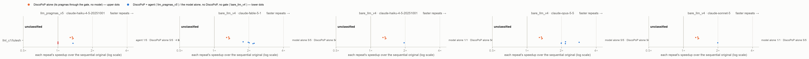

# E6 — a real application: LULESH 2.0

*Generated by `agent/tools/campaign.py reports` from `results/campaign.json` and the experiment record (`agent/THESIS_EXPERIMENTS.md`). Edit those, then regenerate — not this file.*

**Status:** done

## The question

Does the loop — profile, rank, restructure, check, annotate, verify — still work on a real application, where one profile takes tens of gigabytes and the program has dozens of loops: what does the agent reach beside DiscoPoP alone, the model alone and LLNL's own OpenMP version? (RQ3, C1; H4)

## Result in one paragraph

On LULESH 2.0 (one program, five trials per setup, descriptive), DiscoPoP alone reached a race-free FASTER program in 10 of 10 trials (median 1.26× at 6 threads, 1.34× at 12; 7 directives). The agent with Haiku 4.5, its gate tolerating rounding within the measured noise floor (first configuration), was faster in 4 of 5 trials (1.55×–1.86×) but each of those programs is BROKEN — Haiku's atomic/critical accumulation on the two node-force loops makes the output unrepeatable at a fixed thread count (values within 1e-11); the fifth shipped DiscoPoP's own program after DiscoPoP's explorer stopped its queue (B28). Told and gated byte-identical, as the model alone is told (second configuration, the author's decision after the first result), the agent reached a usable program in 5 of 5 trials, every value identical: 1.38×–1.56× at 6 threads, 1.48×–1.93× at 12, 1.08×–1.42× DiscoPoP alone's own (paired) — the gate refused the atomic scatter on a last-digit change, and in 4 of 5 trials Haiku then split each force loop into a parallel compute phase and a sequential scatter. LLNL's own OpenMP version: 2.00× / 1.96×. Models alone: Opus 5.5 and Fable 5.1 usable 5 of 5 (median 1.99× and 2.02× at 6 threads; LLNL-like gather names, probable recall), Sonnet 5 1 of 5, Haiku 4.5 0 of 5 (4 do not compile, 1 racy). The harness's reproducibility check misses: Sonnet's atomic program gave identical digests in all 10 runs and passed it, and so did Haiku's (racy) one.

## Figures

## What is in this folder

- [`analysis/`](analysis/) — the read-out: [`README.md`](analysis/README.md), [`figures.md`](analysis/figures.md), [`main_comparison_stats.md`](analysis/main_comparison_stats.md), [`ranking/e6c_r1.md`](analysis/ranking/e6c_r1.md), [`ranking/e6c_r2.md`](analysis/ranking/e6c_r2.md), [`ranking/e6c_r3b.md`](analysis/ranking/e6c_r3b.md), [`ranking/e6c_smoke3.md`](analysis/ranking/e6c_smoke3.md), [`readout.md`](analysis/readout.md), [`stats_c2/figures.md`](analysis/stats_c2/figures.md), [`stats_c2/main_comparison_stats.md`](analysis/stats_c2/main_comparison_stats.md), [`stats_c2/vs_discopop_alone.md`](analysis/stats_c2/vs_discopop_alone.md), [`vs_discopop_alone.md`](analysis/vs_discopop_alone.md)
- [`exhibits/`](exhibits/) — 11 case studies, below
- [`runs/`](runs/) — 8 archived run(s): the evidence
- [`checks/`](checks/) — 1 verification(s) made during the read-out
- [`preflight/`](preflight/) — 27 smoke run(s) before the launch

## Runs

| run | where | what it is | status | trials | outcomes |
|---|---|---|---|---:|---|
| `e6_lulesh_smoke` | [`preflight/e6_lulesh_smoke/`](preflight/e6_lulesh_smoke/) | E6 pre-flight, step 1 (server, no model): ONE trial of the arm `discopop_capability` on `llnl/lulesh` through the run path — the first time a project-layout C++ package of six units goes through it on the repaired DiscoPoP: does it build, profile and verify, how long does it take, what does DiscoPoP alone keep — launched 13 Oct 22:16 UTC at `90f9b35c4` with `--verify-size STANDARD` (no T0.1 entry yet; a first launch without it was refused before a run existed). Result: PROFILE_ERROR — `lulesh.h` has no include guard and the profile step compiles the six units as one; the package must be repaired before it can be profiled | valid | 1 | PROFILE_ERROR 1 |
| `e6_lulesh_smoke2` | [`preflight/e6_lulesh_smoke2/`](preflight/e6_lulesh_smoke2/) | E6 pre-flight, the smoke again on the repaired package (server, no model): ONE trial of the arm `discopop_capability` on `llnl/lulesh`, `--verify-size STANDARD` — does the profile go through with the include guard, how long, how much memory — 14 Oct 00:38–00:43 UTC at `272cd24b6`: the profile goes through (2.6 s, 7.2 s, explorer 312 s; Do-All 59); the trial then ends AGENT_ERROR on the launcher's flag form (repaired) | valid | 1 | AGENT_ERROR 1 |
| `e6_lulesh_smoke3` | [`preflight/e6_lulesh_smoke3/`](preflight/e6_lulesh_smoke3/) | E6 pre-flight, the smoke a third time (server, no model), after the launcher's flag form was repaired: ONE trial of the arm `discopop_capability` on `llnl/lulesh`, `--verify-size STANDARD` — what DiscoPoP alone reaches on LULESH, how long the trial takes — 14 Oct 01:22–01:31 UTC at `335c0bd84`: the path works; parallel-not-faster (0.17× / 0.09×) at a verification size of 0.068 s serial — not a class measurement | valid | 1 | parallel-not-faster 1 |
| `e6_t0_1_sizes` | [`preflight/e6_t0_1_sizes/`](preflight/e6_t0_1_sizes/) | E6 pre-flight stage 1 (server, no model): T0.1 on llnl/lulesh — size_table.py, serial -O3 per dataset size, 3 runs, NUMA node 0: the verification size (serial ≥ 1 s) and the timing size (≥ 0.25 s) → kernel_sizes.json — 2 Nov 21:01 UTC at `0a3c462e0`: serial 0.0036 s at SMALL, 0.065 s at STANDARD, 1.05 s at LARGE → verification LARGE, timing LARGE (merged) | valid | 0 |  |
| `e6_t0_6_dp_main` | [`preflight/e6_t0_6_dp_main/`](preflight/e6_t0_6_dp_main/) | E6 pre-flight stage 1 (server, no model): T0.6 on llnl/lulesh — dp_main_study.py, one profile as the harness takes it, NUMA node 1: does DiscoPoP alone propose patterns inside main (D4) — 2 Nov 21:01–21:06 UTC: 854 patterns, 324 applicable; 6 in main, all in the package's driver (version 1) | valid | 0 |  |
| `e6_classes_a` | [`preflight/e6_classes_a/`](preflight/e6_classes_a/) | E6 pre-flight stage 2 (server, no model): T0.11 draw a on llnl/lulesh — arm discopop_capability (budget 0, no model), threads 6/12, repeats 5, verification size LARGE from e6_t0_1_sizes, its own fresh profile; lane 0.0 — 2 Nov 21:07–21:12 UTC: parallel-not-faster, 0.17×/0.12× at 6/12 threads (version 1) | valid | 1 | parallel-not-faster 1 |
| `e6_classes_b` | [`preflight/e6_classes_b/`](preflight/e6_classes_b/) | E6 pre-flight stage 2 (server, no model): T0.11 draw b on llnl/lulesh — arm discopop_capability (budget 0, no model), threads 6/12, repeats 5, verification size LARGE from e6_t0_1_sizes, its own fresh profile; lane 0.1 — 2 Nov 21:07–21:12 UTC: parallel-not-faster, 0.16×/0.13× at 6/12 threads (version 1) | valid | 1 | parallel-not-faster 1 |
| `e6_classes_c` | [`preflight/e6_classes_c/`](preflight/e6_classes_c/) | E6 pre-flight stage 2 (server, no model): T0.11 draw c on llnl/lulesh — arm discopop_capability (budget 0, no model), threads 6/12, repeats 5, verification size LARGE from e6_t0_1_sizes, its own fresh profile; lane 1.0 — 2 Nov 21:07–21:12 UTC: parallel-not-faster, 0.19×/0.16× at 6/12 threads (version 1) | valid | 1 | parallel-not-faster 1 |
| `e6_ref_check` | [`preflight/e6_ref_check/`](preflight/e6_ref_check/) | E6 pre-flight stage 2 (server, no model): T0.10/T0.14 — LLNL's OpenMP LULESH (agent/reference_solutions/llnl/lulesh) through `verify-source` at the verification size LARGE, threads 6/12, repeats 5, cores 36-47: does the package accept its expert version, and how fast is it — 2 Nov 21:08 UTC: correct, stable, 2.06× at 6 threads, 1.75× at 12 (version 1) | valid | 1 | FASTER 1 |
| `e6_t0_13_ceiling` | [`preflight/e6_t0_13_ceiling/`](preflight/e6_t0_13_ceiling/) | E6 pre-flight stage 2 (server, no model): T0.13 — default_arm_ceiling.py on llnl/lulesh: LLNL's version with its directives removed, the agent with budget 0 — does DiscoPoP find its parallel loops and do its directives pass the gate; cores 36-47, after e6_ref_check — 2 Nov 21:08–21:14 UTC: AGENT_ABORTED, the agent could not build or run the original (version 1; cause found: LLNL's version without its directives reads per-thread slots it never wrote; T0.13 not applicable to LULESH, §6 2 Nov) | valid | 0 |  |
| `e6_t0_5_shares` | [`preflight/e6_t0_5_shares/`](preflight/e6_t0_5_shares/) | E6 pre-flight stage 2 (server, no model): T0.5 — share_study.py on llnl/lulesh at the agent size and the verification size: which regions pass --min-runtime-share 0.01, how many candidates a trial has, what share LLNL's restructured force routines hold; cores 36-47, after e6_t0_13_ceiling — 2 Nov 21:14–21:16 UTC: 101 regions in scope; 58 loops at --min-runtime-share 0.01 (version 1) | valid | 0 |  |
| `e6c_prepare` | [`preflight/e6c_prepare/`](preflight/e6c_prepare/) | E6 pre-flight on the clean package llnl_c1/lulesh (server, no model): the server builds llnl_c1/lulesh with the generator's validation (clang-20) and its digests are compared with the Mac's (package and harness) — 2 Nov 22:11 UTC: validated under clang-20; all 8 files equal to the Mac's by sha256 | valid | 0 |  |
| `e6c_t0_1_sizes` | [`preflight/e6c_t0_1_sizes/`](preflight/e6c_t0_1_sizes/) | E6 pre-flight on the clean package llnl_c1/lulesh (server, no model): T0.1 on llnl_c1/lulesh — size_table.py, NUMA node 0 → kernel_sizes.json — 2 Nov 22:11 UTC: 1.054 s at LARGE → verification and timing LARGE (merged) | valid | 0 |  |
| `e6c_t0_6_dp_main` | [`preflight/e6c_t0_6_dp_main/`](preflight/e6c_t0_6_dp_main/) | E6 pre-flight on the clean package llnl_c1/lulesh (server, no model): T0.6 on llnl_c1/lulesh — dp_main_study.py, NUMA node 1: LLNL's main now sits in main.cc and is excluded by name; does DiscoPoP propose an applicable pattern there (D4) — 2 Nov 22:11–22:16 UTC: 805 patterns, 305 applicable; 6 in LLNL's main (main.cc), all task patterns, for which DiscoPoP writes no patch | valid | 0 |  |
| `e6c_classes_a` | [`preflight/e6c_classes_a/`](preflight/e6c_classes_a/) | E6 pre-flight on the clean package llnl_c1/lulesh, stage B (server, no model): T0.11 draw a — arm discopop_capability (budget 0, no model), threads 6/12, repeats 5, verification size LARGE from e6c_t0_1_sizes, its own fresh profile; lane 0.0 — 2 Nov 22:22–22:26 UTC: parallel-not-faster, 0.17×/0.13× at 6/12 threads; the 10 Do-All directives of version 1, not its two task groups | valid | 1 | parallel-not-faster 1 |
| `e6c_classes_b` | [`preflight/e6c_classes_b/`](preflight/e6c_classes_b/) | E6 pre-flight on the clean package llnl_c1/lulesh, stage B (server, no model): T0.11 draw b — arm discopop_capability (budget 0, no model), threads 6/12, repeats 5, verification size LARGE from e6c_t0_1_sizes, its own fresh profile; lane 0.1 — 2 Nov 22:22–22:26 UTC: parallel-not-faster, 0.16×/0.13× at 6/12 threads; the 10 Do-All directives of version 1, not its two task groups | valid | 1 | parallel-not-faster 1 |
| `e6c_classes_c` | [`preflight/e6c_classes_c/`](preflight/e6c_classes_c/) | E6 pre-flight on the clean package llnl_c1/lulesh, stage B (server, no model): T0.11 draw c — arm discopop_capability (budget 0, no model), threads 6/12, repeats 5, verification size LARGE from e6c_t0_1_sizes, its own fresh profile; lane 1.0 — 2 Nov 22:22–22:26 UTC: parallel-not-faster, 0.18×/0.16× at 6/12 threads; the 10 Do-All directives of version 1, not its two task groups | valid | 1 | parallel-not-faster 1 |
| `e6c_ref_check` | [`preflight/e6c_ref_check/`](preflight/e6c_ref_check/) | E6 pre-flight on the clean package llnl_c1/lulesh, stage B (server, no model): T0.10/T0.14 — LLNL's OpenMP version in the clean layout (reference_solutions/llnl_c1/lulesh) through verify-source at LARGE, threads 6/12, repeats 5, cores 36-47 — 2 Nov 22:22 UTC: correct, 2.00× | valid | 1 | FASTER 1 |
| `e6c_t0_5_shares` | [`preflight/e6c_t0_5_shares/`](preflight/e6c_t0_5_shares/) | E6 pre-flight on the clean package llnl_c1/lulesh, stage B (server, no model): T0.5 — share_study.py on llnl_c1/lulesh at the agent size and LARGE; cores 36-47, after e6c_ref_check — 2 Nov 22:23–22:25 UTC: the tool saw only main.cc's two regions (a limit of share_study.py on this layout); the agent's own measurement ranks 44 regions (§6) | valid | 0 |  |
| `e6c_requests` | [`preflight/e6c_requests/`](preflight/e6c_requests/) | E6 pre-flight (server, no model): show_requests.py on e6c_classes_a's profile of llnl_c1/lulesh, routing as the agent routes (a region DiscoPoP reports with an applicable pattern is deferred, not sent) — the agent's first request in the model-writes mode at prompt version 5 (llm_pragmas_v5), the model alone's mirror at version 4 (bare_llm_v4; version 5 has no mirror), the queue and the files both working copies hold: what the author is shown before any model call (rule of 4 Oct). A first rendering without the routing showed a deferred Do-All loop and was replaced — 2 Nov: queue 100 regions, 45 sent to the model; the first request (CalcMonotonicQRegionForElems' loop) names 27 compiler temporaries (callNN) in its digest (§6) | valid | 0 |  |
| `e6c_nofold_patterns` | [`preflight/e6c_nofold_patterns/`](preflight/e6c_nofold_patterns/) | E6 diagnostic (server, no model): the variant llnl_c1_nofold (the per-thread minimum unfolded; never an experiment's package) built with the generator's validation and profiled once (dp_main_study.py, node 1): which of the clean package's edits changes DiscoPoP's task patterns — 3 Nov 23:31–00:03 UTC: the fold accounts for the two Do-All patterns (merge loops that run zero times); the task patterns follow from main's move (§6) | valid | 0 |  |
| `e6c_smoke` | [`preflight/e6c_smoke/`](preflight/e6c_smoke/) | E6 smoke (server, MODEL): one trial of llm_pragmas_v5 on llnl_c1/lulesh, Haiku 4.5, --threads 6,12 --repeats 5 --timeout 43200, lane 0.0 — the pre-registered criterion of 3 Nov — STOPPED 3 Nov 01:19 UTC after 70 min to apply Fix 110 (a stall cost the 3,127 s limit): partial record, no trial; 9 calls, $2.89, not counted (§6) | valid | 0 |  |
| `e6c_smoke_bare` | [`preflight/e6c_smoke_bare/`](preflight/e6c_smoke_bare/) | E6 smoke (server, MODEL): one trial of bare_llm_v4 on llnl_c1/lulesh, Haiku 4.5, --threads 6,12 --repeats 5 --timeout 43200, lane 0.1 — the pre-registered criterion of 3 Nov — 3 Nov 00:06–00:17 UTC: VERIFY_FAILED, 63 directives, the program does not compile (loop-body names in clauses); 1 call, $0.77 | valid | 1 | VERIFY_FAILED 1 |
| `e6c_requests_fix109` | [`preflight/e6c_requests_fix109/`](preflight/e6c_requests_fix109/) | E6 pre-flight (server, no model): show_requests.py on e6c_classes_a's profile of llnl_c1/lulesh again, at the commit with Fix 109 — the agent's first request (version 5, the model writes the directives) as it is now sent: the digest without compiler names — 3 Nov: no compiler name left; the digest ends 'memory DiscoPoP could not name' | valid | 0 |  |
| `e6c_smoke2` | [`preflight/e6c_smoke2/`](preflight/e6c_smoke2/) | E6 smoke again (server, MODEL): one trial of llm_pragmas_v5 on llnl_c1/lulesh, Haiku 4.5, --threads 6,12 --repeats 5 --timeout 43200, lane 0.0, with Fix 110 (the explorer limit 910 s) — the pre-registered criterion of 3 Nov — PROFILE_ERROR 3 Nov 03:0x UTC: the explorer ran away in all five attempts (B28); no model call (§6) | valid | 1 | PROFILE_ERROR 1 |
| `e6c_smoke3` | [`preflight/e6c_smoke3/`](preflight/e6c_smoke3/) | E6 smoke, third run (server, MODEL): one trial of llm_pragmas_v5 on llnl_c1/lulesh, Haiku 4.5, --threads 6,12 --repeats 5 --timeout 43200, lane 0.0, with Fixes 110-112 — the pre-registered criterion of 3 Nov — 3 Nov 03:11–08:35 UTC: BROKEN (values within 8.3e-14, 1.99× at 6 threads, but not reproducible at fixed threads: per-thread force arrays added under critical); 40 calls, $9.97; criterion held (§6) | valid | 1 | BROKEN 1 |
| `e6c_r1` | [`runs/e6c_r1/`](runs/e6c_r1/) | E6 main run (server, MODEL), pre-registered 3 Nov: discopop_gate_v5 and llm_pragmas_v5 (Haiku 4.5) on llnl_c1/lulesh, --trials 2 --threads 6,12 --repeats 5 --timeout 43200, lane 0.0 — 3 Nov 08:41–19:0x UTC: DiscoPoP alone FASTER 2 of 2 (1.28×, 1.26× at 6 threads); the agent BROKEN 2 of 2 on reproducibility alone (1.86×/2.10×, 1.55×/1.85×; atomic/critical on the force accumulation); 74 calls, $19.33 | valid | 4 | BROKEN 2, FASTER 2 |
| `e6c_r2` | [`runs/e6c_r2/`](runs/e6c_r2/) | E6 main run (server, MODEL), pre-registered 3 Nov: discopop_gate_v5 and llm_pragmas_v5 (Haiku 4.5) on llnl_c1/lulesh, --trials 2, lane 0.1 — 3 Nov 08:41–21:24 UTC: DiscoPoP alone FASTER 2 of 2 (1.27×, 1.28× at 6 threads); the agent BROKEN 2 of 2 on reproducibility alone (1.67×/1.86×, 1.79×/2.08×; atomic/critical on the force accumulation); 78 calls, $17.79 | valid | 4 | BROKEN 2, FASTER 2 |
| `e6c_r3` | [`runs/e6c_r3/`](runs/e6c_r3/) | E6 main run (server, MODEL), pre-registered 3 Nov: discopop_gate_v5 and llm_pragmas_v5 (Haiku 4.5) on llnl_c1/lulesh, --trials 1, lane 1.0 — PROFILE_ERROR 3 Nov ~09:30 UTC: the first profile's explorer stopped in all five attempts (B28); no trial, no call (§6) | valid | 2 | PROFILE_ERROR 2 |
| `e6c_bare` | [`runs/e6c_bare/`](runs/e6c_bare/) | E6 main run (server, MODEL), pre-registered 3 Nov: bare_llm_v4 on llnl_c1/lulesh for claude-haiku-4-5-20251001, claude-sonnet-5, claude-opus-5-5, claude-fable-5-1, --trials 5 --threads 6,12 --repeats 5 --timeout 43200, lane 1.1 — 3 Nov 08:42–11:0x UTC: Fable 5/5 and Opus 5/5 FASTER (values identical), Sonnet 1/5 and Haiku 1/5 (the rest do not compile); Haiku rep 1 a failed call (error_max_turns), moved to _invalid_call_failed/ and re-run under this run id 3 Nov 21:33–21:39 UTC, lane 0.1: VERIFY_FAILED (a clause on the force loop names `ss1`, undeclared there), so Haiku alone FASTER 1 of 5 (§6) | valid | 20 | FASTER 12, VERIFY_FAILED 8 |
| `e6c_r3b` | [`runs/e6c_r3b/`](runs/e6c_r3b/) | E6 main run (server, MODEL), replacing e6c_r3 on a new profile: discopop_gate_v5 and llm_pragmas_v5 (Haiku 4.5) on llnl_c1/lulesh, --trials 1 --threads 6,12 --repeats 5 --timeout 43200, lane 1.0 — 3 Nov 09:39–13:1x UTC: DiscoPoP alone FASTER 1.26×/1.35×; the agent FASTER 1.27×/1.35× with DiscoPoP's program (floor, D32) after B28 stopped its re-profile — 22 regions not attempted; 15 calls, $4.21 | valid | 2 | FASTER 2 |
| `e6x_1` | [`runs/e6x_1/`](runs/e6x_1/) | E6 second configuration (server, MODEL), pre-registered 3 Nov: discopop_gate_v5 and llm_pragmas_v5_exact (Haiku 4.5) on llnl_c1/lulesh, --threads 6,12 --repeats 5 --timeout 43200, --trials 2, lane 0.0 — started 3 Nov 21:33 UTC at `2f2e7d535` — ended 4 Nov 07:39 UTC: DiscoPoP alone FASTER 2 of 2 (1.27×, 1.26× at 6 threads); the agent FASTER 2 of 2 with every value identical (1.38×/1.48× with the force loops sequential; 1.49×/1.82× with both split into a parallel compute phase and a sequential scatter); 70 calls, $15.09 | valid | 4 | FASTER 4 |
| `e6x_2` | [`runs/e6x_2/`](runs/e6x_2/) | E6 second configuration (server, MODEL), pre-registered 3 Nov: discopop_gate_v5 and llm_pragmas_v5_exact (Haiku 4.5) on llnl_c1/lulesh, --threads 6,12 --repeats 5 --timeout 43200, --trials 2, lane 1.0 — started 3 Nov 21:33 UTC at `2f2e7d535` — ended 4 Nov 10:23 UTC: DiscoPoP alone FASTER 2 of 2 (1.26×, 1.27× at 6 threads); the agent FASTER 2 of 2 with every value identical (1.48×/1.74×, 1.54×/1.93×; both force loops split into a parallel compute phase and a sequential scatter); 93 calls, $22.35 | valid | 4 | FASTER 4 |
| `e6x_3` | [`runs/e6x_3/`](runs/e6x_3/) | E6 second configuration (server, MODEL), pre-registered 3 Nov: discopop_gate_v5 and llm_pragmas_v5_exact (Haiku 4.5) on llnl_c1/lulesh, --threads 6,12 --repeats 5 --timeout 43200, --trials 1, lane 1.1 — started 3 Nov 21:33 UTC at `2f2e7d535` — ended 4 Nov 04:57 UTC: DiscoPoP alone FASTER (1.17×/1.32×); the agent FASTER 1.56×/1.78× with every value identical (force loops split into a parallel compute phase and a sequential scatter in element order); 36 calls, $8.13 | valid | 2 | FASTER 2 |
| `e6c_race_check` | [`checks/e6c_race_check/`](checks/e6c_race_check/) | E6's registered race check (server, no model): race_check.py over every program of the agent (e6c_smoke3, e6c_r1, e6c_r2, e6c_r3b), of the second configuration (e6x_1-3), of the models alone (e6c_bare, with the re-run Haiku trial) and of DiscoPoP alone (the positive control); run after the second configuration ends, so the sync it needs falls between runs; four parts, one per 12-core group — second attempt 4 Nov 10:36–10:39 UTC at `72b1f89a5` (the first void: project flags missing): 41 programs; every agent program (11) and every DiscoPoP-alone program (10, the control) clean; models alone: Fable 5, Opus 5, Sonnet 1 clean, Haiku's one FASTER program racy (`courant_elem` written by every thread), the 8 others do not compile | valid | 0 |  |

## Exhibits

- [`e6_bare_haiku_racy`](exhibits/e6_bare_haiku_racy/) — Haiku 4.5 alone, rep 5: the one model-alone Haiku program the harness scores FASTER (1.95×/1.69×) has a data race — courant_elem is left shared in the Courant minimum loop — found only by the race check; it also puts atomic additions on both force loops and still passed the repeatability check.  
  **better** vs DiscoPoP alone (1.34× → 1.95×) · llnl_c1/lulesh, `bare_llm_v4`, e6c_bare rep 5 · pictures: `before_after.png`, `console.png`
- [`e6_bare_opus_gather_best`](exhibits/e6_bare_opus_gather_best/) — Opus 5.5 alone, rep 4: a node-to-corner gather in element order, every value identical, 2.53×/2.84× — the fastest E6 program, above LLNL's own 2.00×/1.96× (LLNL-like names: probable recall).  
  **better** vs DiscoPoP alone (1.34× → 2.84×) · llnl_c1/lulesh, `bare_llm_v4`, e6c_bare rep 4 · pictures: `before_after.png`, `console.png`
- [`e6_bare_sonnet_atomic_passes`](exhibits/e6_bare_sonnet_atomic_passes/) — Sonnet 5 alone, rep 1: atomic updates on both force scatters, the construction that made the agent's programs BROKEN, yet its digest is identical in all 10 runs (5 at 6, 5 at 12 threads) — FASTER (1.99×/1.99×): the reproducibility check missed it.  
  **better** vs DiscoPoP alone (1.34× → 1.99×) · llnl_c1/lulesh, `bare_llm_v4`, e6c_bare rep 1 · pictures: `before_after.png`, `console.png`
- [`e6_c1_atomic_broken_r1a`](exhibits/e6_c1_atomic_broken_r1a/) — First configuration, e6c_r1 rep 1: the agent with Haiku parallelizes LULESH's force scatter with 27 atomic and 2 critical directives, 1.86×/2.10×, every value within 4.8e-14 — BROKEN because the output is not repeatable at a fixed thread count, the gate having accepted it within the measured noise floor.  
  **unsafe** vs DiscoPoP alone (1.34× → 1.00×) · llnl_c1/lulesh, `llm_pragmas_v5`, e6c_r1 rep 1 · pictures: `before_after.png`, `rejected_attempt.png`, `console.png`
- [`e6_c1_atomic_broken_r1b`](exhibits/e6_c1_atomic_broken_r1b/) — First configuration, e6c_r1 rep 2: the same atomic force scatter, 1.55×/1.84×, values within 2.8e-13, BROKEN on reproducibility alone; B28 cut its queue.  
  **unsafe** vs DiscoPoP alone (1.34× → 1.00×) · llnl_c1/lulesh, `llm_pragmas_v5`, e6c_r1 rep 2 · pictures: `before_after.png`, `rejected_attempt.png`, `console.png`
- [`e6_c1_atomic_broken_r2a`](exhibits/e6_c1_atomic_broken_r2a/) — First configuration, e6c_r2 rep 1: atomic/critical on the hourglass scatter only, 1.67×/1.86×, values within 3.2e-12, BROKEN on reproducibility alone.  
  **unsafe** vs DiscoPoP alone (1.31× → 1.00×) · llnl_c1/lulesh, `llm_pragmas_v5`, e6c_r2 rep 1 · pictures: `before_after.png`, `rejected_attempt.png`, `console.png`
- [`e6_c1_atomic_broken_r2b`](exhibits/e6_c1_atomic_broken_r2b/) — First configuration, e6c_r2 rep 2: atomic force scatter (27 atomic, 2 critical), 1.79×/2.08× — faster than LLNL's version at 12 threads, yet BROKEN on reproducibility alone.  
  **unsafe** vs DiscoPoP alone (1.31× → 1.00×) · llnl_c1/lulesh, `llm_pragmas_v5`, e6c_r2 rep 2 · pictures: `before_after.png`, `rejected_attempt.png`, `console.png`
- [`e6_c1_queue_cut_floor_r3b`](exhibits/e6_c1_queue_cut_floor_r3b/) — First configuration, e6c_r3b: DiscoPoP's explorer stalls in every retry after the 8th rewrite (B28), 22 regions are never attempted, and the agent's program at 0.95× DiscoPoP alone's is replaced by DiscoPoP's own (floor, D32).  
  **equal** vs DiscoPoP alone (1.35× → 1.35×) · llnl_c1/lulesh, `llm_pragmas_v5`, e6c_r3b rep 1 · pictures: `before_after.png`, `rejected_attempt.png`, `console.png`
- [`e6_c2_atomic_refused_sequential`](exhibits/e6_c2_atomic_refused_sequential/) — Second configuration, e6x_1 rep 1: told byte-identical, Haiku writes the atomic scatter again, the gate refuses it on a last-digit change (pb_sum …267 vs …272), the model withdraws it — force loops sequential, 1.38×/1.48×, every value identical.  
  **equal** vs DiscoPoP alone (1.34× → 1.48×) · llnl_c1/lulesh, `llm_pragmas_v5_exact`, e6x_1 rep 1 · pictures: `before_after.png`, `rejected_attempt.png`, `console.png`
- [`e6_c2_split_best12`](exhibits/e6_c2_split_best12/) — Second configuration, e6x_2 rep 2: the same split after refused attempts on both force loops, 1.54×/1.93× (LLNL: 1.96× at 12 threads), 1.42× DiscoPoP alone's own, every value identical.  
  **better** vs DiscoPoP alone (1.32× → 1.93×) · llnl_c1/lulesh, `llm_pragmas_v5_exact`, e6x_2 rep 2 · pictures: `before_after.png`, `rejected_attempt.png`, `console.png`
- [`e6_c2_split_best6`](exhibits/e6_c2_split_best6/) — Second configuration, e6x_3: after the atomic scatter is refused, Haiku splits each force loop into a parallel loop computing every element's corner forces into buffers and a sequential loop adding them in element order — every value identical, 1.56×/1.78×, the best at 6 threads.  
  **better** vs DiscoPoP alone (1.32× → 1.78×) · llnl_c1/lulesh, `llm_pragmas_v5_exact`, e6x_3 rep 1 · pictures: `before_after.png`, `rejected_attempt.png`, `console.png`

## From the experiment record (§7 run log)

### `e6c_r1`, `e6c_r2`, `e6c_r3`, `e6c_r3b`, `e6c_bare`; `e6x_1`, `e6x_2`, `e6x_3`; `e6c_race_check` — 2026-11-03/04, server, **E6: LULESH 2.0 with a model — the agent (two configurations), DiscoPoP alone and four models alone** (10 agent, 10 DiscoPoP-alone and 20 model-alone trials counted)

- **Deviations first** (§6, 3 and 4 Nov): the server checkout fast-forwarded during the first runs (registry and docs only); the smoke stopped to apply Fix 110; a sync during runs before `e6c_r3b`; `e6c_r3`'s first profile failed in all five explorer attempts (B28, no trial); B28 cut the queues of `e6c_r1` rep2 and `e6c_r3b`; Haiku-alone rep 1 a failed call (`error_max_turns`), set aside under `_invalid_call_failed/` and re-run; the second configuration's first launch failed on zsh word splitting before profiling; the race check's first attempt void (project flags missing in `race_check.py`, 41 of 41 at `compile`), repaired and re-run.
- **Setup.** Pre-registered §6 3 Nov ("E6 pre-registered"): `llnl_c1/lulesh`, LARGE, `--threads 6,12 --repeats 5 --timeout 43200`, Haiku 4.5. First configuration `discopop_gate_v5` + `llm_pragmas_v5` (`e6c_r1`, `e6c_r2`, `e6c_r3b`; 3 Nov 08:41–21:24 UTC at `7926675a7c`); models alone `bare_llm_v4` × 5 for Haiku 4.5, Sonnet 5, Opus 5.5, Fable 5.1 (`e6c_bare`, 3 Nov 08:42–11:0x, Haiku rep 1 re-run 21:33–21:39 at `2f2e7d535`). Second configuration, the author's decision after the first's result (§6 3 Nov, "yes go with option 2"): `discopop_gate_v5` + `llm_pragmas_v5_exact` (= `--no-numeric-tolerance`; `e6x_1`, `e6x_2`, `e6x_3`; 3 Nov 21:33 – 4 Nov 10:23 UTC at `2f2e7d535`).
- **Checks** (server, no model): `e6c_race_check` (4 Nov 10:36–10:39 at `72b1f89a5`) — every agent program (11) and every DiscoPoP-alone program (10, the control) clean; models alone Fable 5, Opus 5, Sonnet 1 clean, Haiku's one FASTER program racy; the ranking comparison without the measurement (`analysis/ranking/`, Mac, no profiling).
- **Result:** §6 4 Nov ("E6 read out"); `results/E06_lulesh/` — `analysis/readout.md` (the registered read-out), `analysis/main_comparison_stats.md` (first configuration), `analysis/stats_c2/`, `checks/e6c_race_check/`, `exhibits/` (eleven case studies). DiscoPoP alone usable 10 of 10 (1.26× at 6 threads); the agent 1 of 5 in the first configuration (4 BROKEN on reproducibility), 5 of 5 in the second (1.49×, every value identical); LLNL 2.00×; models alone Fable 5, Opus 5, Sonnet 1, Haiku 0.

## Change-log rows that name these runs (§6)

| Date | Repo | Change | Why |
|---|---|---|---|
| 2026-11-02 | result | **E6 on the clean package, stage A (server, no model; 2 Nov 22:11–22:16 UTC at `1f17c1b22`; archived, valid).** `e6c_prepare`: the server built `llnl_c1/lulesh` with the generator's validation under clang-20 (MINI and SMALL: the original's deterministic output equals the package's; the seeded input deterministic, changes the output, finite) and **all eight files — the six units, meta.json and the harness header — have the same sha256 on the server and on the Mac**. `e6c_t0_1_sizes` (T0.1, node 0): 0.0036 s at SMALL, 0.065 s at STANDARD, 1.054 s at LARGE → verification and timing size LARGE, as for version 1; merged into `config/kernel_sizes.json` (`llnl_c1/lulesh`). `e6c_t0_6_dp_main` (T0.6, node 1): 805 patterns, 305 applicable; **6 in `main` — which is now LLNL's own `main` in `main.cc` — 2 of them applicable, all six task patterns** (the time-step loop and the block of start-up prints, `#pragma omp parallel` + `single` with `task`s). DiscoPoP's patch generator writes no patch for a task pattern (`plan/regions.py`), so no arm — DiscoPoP alone included — can apply them, and excluding `main` by name (D4) removes nothing that could be applied; `main.cc` is not editable in any case. | — |
| 2026-11-05 | result | **E11 pre-flight, stage B (server, no model; 5 Nov 21:49–21:58 UTC at `43f821439`).** `e11_ref_check` — the three programs judged without a model (whole file, same package, verification size, 6/12 threads, 5 repeats; sequential input 1.15 s for EP at class W, 19.8 s for CG at class B): **RepoOMP's Claude Sonnet 4.5 programs are FASTER on both** — EP 5.87×/8.61×, CG 5.73×/10.05× at 6/12 threads, every value identical to the input's. NPB's own OpenMP version: CG FASTER 5.79×/10.33× (values identical); **EP BROKEN by the output comparison only** — NPB's original prints its full report (header, the two sums, the ten counts), which RepoOMP's input no longer prints, so the value lists differ in length (`dump_max_rel_err` inf); its time was measured as for every program (5.16×/8.68×) and NPB's own verification of it is read by `second_class.py`. It is reported so, not edited. RepoOMP's Claude Code programs: EP SCAFFOLD_MODIFIED — the released file ends at line 128, inside an `#if`, without `timer_stop(1)`, and does not compile ("expected '}'"): reported as a truncated file that does not build; CG BROKEN — its values differ from the input's (on the Mac at class S NPB's verification failed; the server's verdict follows from `second_class.py`). The timed region was checked for all six (Fix 114): no line left it. `e11_requests` (`show_requests.py` on draw a's profile, which the harness made before the agent started): the agent's texts in the model-writes mode at version 5 and the model alone's at version 4 are archived — the model reads `ep.c`/`cg.c` without anything of ours; the two shared units it may read include the harness header by name, as LULESH's `main.cc` did; the tool exits 1 after the agent's texts at version 5 because no model-alone mirror exists at version 5 (as in `e6c_requests`). **Deviation — the three DiscoPoP-alone draws are void:** every trial ended AGENT_ERROR before any step, because the agent, given a project without a source file, started on the first unit (`c_print_results.c`), which it may not change. Fix 115: it starts on the first editable file (no other package affected: in the 148 others the editable file is the first unit). The void runs are set aside on the server (`runs/_set_aside/e11_classes_<x>_void_default_source_20261105`) and the three draws (`e11_classes_a`, `e11_classes_b`, `e11_classes_c`) run again under the same ids. | Result + Deviation |
| 2026-11-05 | result | **E11 pre-flight, stage A (server, no model; 5 Nov 21:28–21:37 UTC at `d8b55a05e`; archived, valid).** `e11_prepare`: the server built `npbc_c1/ep` and `npbc_c1/cg` with the generator's validation under clang-20 at every size (the original's output equals the package's; NPB's verification SUCCESSFUL at classes S, W, A, B) and **all 19 files — both packages with their meta.json, and the harness header — have the same sha256 on the server and on the Mac**; the tracked expert and third-party copies came out unchanged. `e11_t0_1_sizes` (T0.1, node 0, serial, median of 3): EP 0.58 s at class S, 1.15 s at W → verification STANDARD (class W), timing SMALL (class S); CG 0.011 s at S, 0.079 s at W, 0.31 s at A, 19.55 s at B → verification EXTRALARGE (class B), timing LARGE (class A); merged into `config/kernel_sizes.json`. The second class of NPB's own verification (the design's substitute for a second input) is therefore class B for EP and class A for CG — the classes RepoOMP measured (`analysis/second_class.py`, fixed now). `e11_exact_repeat_test` (`race_check.py --exact-repeat`, the 41 E6 programs): **the rule written before the test is not met — the setting is not adopted, E11 runs `llm_pragmas_v5` as decided.** All four programs of E6's first configuration that the harness found unrepeatable came out clean (with the smoke trial's, five of five atomic/critical programs), as did the first configuration's fifth, the second configuration's five and DiscoPoP alone's ten; the models alone as in `e6c_race_check` (Fable 5, Opus 5 and Sonnet's one compiled program clean — Sonnet's atomic program too; Haiku's FASTER program racy under ThreadSanitizer; the other nine do not compile). What it shows: the gate's matrix runs a program three times at its largest thread count, 4, while the harness found these programs unrepeatable over five runs at 6 and 12 threads; at 4 threads the order of the atomic updates did not change the printed digits in three runs. Comparing those repeats exactly does not close the gap E6 found; more threads or repeats in the gate would be a different change, not tested (one pass, no tuning, as fixed). Fix 113 stays in the agent, off by default. | Result |
| 2026-11-05 | pre-registration | **E11 — the package, two changes to the gate and the judge, and the test of the middle setting, written before the test runs.** *Package* (`prepare_apps.py npbc_ep npbc_cg`, suite `npbc_c1`, generator 1): RepoOMP's input as `ep.c`/`cg.c`, byte for byte (no comments in either); NPB's `npb-C.h`, `c_randdp.c`, `wtime.c`, `wtime.h` without their comments and `npbparams.h` (NPB's setparams output for classes S/W/A/B behind the dataset macro, `COMPILETIME` fixed, without comments) in one directory — the rule of 4 Oct (a file a model can read is an ordinary code file); `c_timers.c` and `c_print_results.c` are two lines that include the harness header outside the package. Sizes: MINI and SMALL = class S (the profile), STANDARD = W, LARGE = A, EXTRALARGE = B. Validated on the Mac at MINI, STANDARD and LARGE (the original's output equals the package's; NPB's verification SUCCESSFUL). The three judged programs are written in the same package, only the program file differing: NPB's own OpenMP version (`reference_solutions/npbc_c1/<k>`), RepoOMP's Claude program and its Claude Code program (`comparison_programs/<label>/npbc_c1/<k>`), each byte for byte as released. *Correction of the decision row below:* the timed region's two ends are NPB's own `timer_start(1)` and `timer_stop(1)` in the benchmark's file, which every candidate edits — not only in the shared units. *Fix 114 (the judge):* the harness's scaffolding check now treats them as it treats its own timer (meta.json `timed_region`): a removed, added or reordered timer line, or an unchanged line that left the region, makes the trial SCAFFOLD_MODIFIED; `verify-source` applies the same check to the three judged programs. Tested: a moved `timer_stop(1)` fails (EP 46, CG 15 lines left the region), a removed one fails, `timer_start(1)` moved earlier passes; RepoOMP's Claude programs and NPB's OpenMP versions pass. **Found:** RepoOMP's released Claude Code EP program (`NPB_cc/ep_claude.c`) ends at line 128 of the input's 169, inside an `#if` — it lacks `timer_stop(1)` and does not compile; it is judged as released. *Fix 113 (the gate, `--exact-repeat`, off by default; the model reads nothing new):* the gate's repeated runs at one thread count must print identical output; rounding stays tolerated across thread counts and schedules. Found on the way: the gate's own message and the help of `--schedule-stress` said such runs fail "independent of how small the difference is", but the code compared them within the noise floor. *The test (registered run `e11_exact_repeat_test`, server, no model):* `race_check.py --exact-repeat` on every E6 program `e6c_race_check` checked (41). **Rule, fixed now:** the setting is adopted for E11 — as a new arm, `llm_pragmas_v5` plus `--exact-repeat`, nothing else different — only if it refuses all four programs of E6's first configuration that the harness found unrepeatable and keeps every program `e6c_race_check` found clean among the agent's other trial of that configuration, the second configuration's five and DiscoPoP alone's ten (the control); refusing a model-alone program that updates a sum with `atomic` (Sonnet's, Haiku's) is what the setting is for and does not count against it. Otherwise E11 runs `llm_pragmas_v5` as decided. One pass, no tuning. | Pre-registration |
| 2026-11-04 | finding | **E6 read out (registered read-out: `results/E06_lulesh/analysis/readout.md`, `main_comparison_stats.md` (first configuration), `stats_c2/`; descriptive, no test).** Population: one program, five trials per setup; the first configuration's agent trials are `e6c_r1` ×2, `e6c_r2` ×2, `e6c_r3b` (the smoke `e6c_smoke3` and `e6c_r3`, whose first profile failed, are not counted). *Usable* = FASTER by the harness and clean in the race check. **DiscoPoP alone:** usable 10 of 10 — median 1.26× at 6 threads (1.17×–1.28×), 1.34× at 12 (1.27×–1.35×), 7 directives (6 in one trial). **The agent, first configuration:** usable 1 of 5 — the four others BROKEN on reproducibility alone (1.55×–1.86× at 6 threads, values within 1e-11, `atomic`/`critical` on the force scatter, no data race), the usable one DiscoPoP's own program (floor) after B28 cut the queue; 167 calls, $41.33, median 5.1 h. **The agent, second configuration:** usable 5 of 5, every value identical — median 1.49× at 6 threads (1.38×–1.56×), 1.78× at 12 (1.48×–1.93×); against DiscoPoP alone of the same run 1.08×–1.34× at 6 threads, 1.08×–1.42× paired (floor); 199 calls, $45.58, median 6.1 h. **LLNL's OpenMP version:** 2.00× / 1.96× (values within 1.0e-14, stable). **The models alone (5 each):** Fable 5.1 usable 5 (median 2.02× / 1.87×, $20.72), Opus 5.5 5 (1.99× / 2.14×, $5.97), Sonnet 5 1 (1.99× / 1.99×, $9.40; 4 do not compile), Haiku 4.5 0 ($3.88; 4 do not compile, 1 racy). **The pre-registered expectations:** (a) *the agent ships no unusable program* — not held in the first configuration (4 of 5 BROKEN), held in the second (0 of 5); (b) *DiscoPoP alone keeps few directives and ends between no change and a modest speedup* — held (7 of the 14 usable, 1.17×–1.28×); (c) *the agent faster than DiscoPoP alone in most trials* — first configuration: faster in 4, but those 4 are BROKEN and the usable one is DiscoPoP's program (1.00×), so not held; second: 5 of 5, held; (d) *below LLNL's 2.00×* — held for every usable program (at most 1.56× at 6 threads, 1.93× against 1.96× at 12); two BROKEN programs of the first configuration passed LLNL at 12 threads (2.10×, 2.08×); (e) *some model-alone programs, Haiku's and Sonnet's first, unusable* — held (Haiku 5 of 5, Sonnet 4 of 5; Opus and Fable none). Second configuration: (a) held; (b) Haiku found a reproducible restructuring of the force loops in 4 of 5 trials (1.48×–1.56× at 6 threads), and the trial without it (1.38×) lies between DiscoPoP alone and the first configuration, as written. **Findings beyond the expectations.** (1) *The harness's reproducibility check is a detector with misses, not a proof:* Sonnet alone's one FASTER program puts `#pragma omp atomic update` on both force scatters — the construction that made the agent's first-configuration programs BROKEN — and its digest came out identical in all 10 runs (5 at 6 threads, 5 at 12), so it passed (values within 3.2e-12): the check missed it — and it missed Haiku alone's FASTER program too, which has atomic additions on both force loops as well (and the data race above). The four BROKEN programs of the first configuration are the ones it caught; an atomic accumulation that passes it is not shown to be repeatable. *(Haiku's case added the same day, from the read-out's finer force-loop labels.)* (2) *The matched comparison is Haiku's:* Haiku alone usable 0 of 5, the agent with Haiku 1 of 5 (first) and 5 of 5 (second); the agent was not run with Opus or Fable, so their 5 of 5 alone (faster than the agent with Haiku, and with LLNL-like gather names: probable recall, §6 3 Nov) is a comparison of models, not of setups. (3) *What the gate's message did:* in the second configuration every atomic scatter Haiku wrote was refused on a changed last digit, and the next answer either withdrew it (1 trial) or split the loop (4); the first configuration accepted the same scatter within the noise floor. **Correction of my rows above:** the row "`e6x_3` done … and `e6x_2`'s first agent trial" said both split trials lay inside the first configuration's range; `e6x_2`'s first (1.48× at 6 threads) lies below it; and the range quoted there and in "second configuration complete" (1.55×–1.99×) includes the smoke trial — over the five counted trials it is 1.55×–1.86×. | analysis |
| 2026-11-04 | result | **E6: the race check (`e6c_race_check`, server, no model; 4 Nov 10:36–10:39 UTC at `72b1f89a5`; archived under `results/E06_lulesh/checks/`).** The gate's race stages (archer ThreadSanitizer, the 7-run schedule matrix with `schedule(runtime)`, output against the original on both inputs, the noise floor captured as the agent captures it, 3.49e-14) over 41 programs. **DiscoPoP alone (the positive control): 10 of 10 clean.** **The agent, first configuration:** 6 of 6 clean (`e6c_smoke3`, `e6c_r1` ×2, `e6c_r2` ×2, `e6c_r3b`) — the four BROKEN ones compared numerically, within the floor: their atomics are no data race, and their BROKEN verdict (not repeatable at a fixed thread count) stands, from the harness. **The agent, second configuration:** 5 of 5 clean, compared exactly. **The models alone:** Fable 5.1 5 of 5 clean, Opus 5.5 5 of 5 clean, Sonnet 5 its one FASTER program clean (4 do not compile), **Haiku 4.5 its one FASTER program racy** — `#pragma omp parallel for reduction(min:dtcourant_tmp)` in `CalcCourantConstraintForElems` leaves `courant_elem` shared, every thread writes it (TSan: write of size 4 by T2, previous by the main thread, line 1960); nothing reads it afterwards, so the output passed (values within 5.9e-15, stable), but the program has a data race; its 4 others do not compile. So Haiku alone ends with no race-free FASTER program. | — |
| 2026-11-04 | plan | **E6: the race check starts (`e6c_race_check`, no model; 4 Nov after 10:23 UTC, nothing else running).** Every E6 run archived and committed, the server synced; `analysis/race_launch/e6c_race.sh` as recorded (four parts in parallel: agent `e6c_smoke3,e6c_r1,e6c_r2,e6c_r3b` arm `llm_pragmas_v5` on cores 0–11; exact `e6x_1–3` arm `llm_pragmas_v5_exact` on 12–23; bare `e6c_bare` arm `bare_llm_v4` on 24–35; control `e6c_r1,e6c_r2,e6c_r3b,e6x_1–3` arm `discopop_gate_v5` on 36–47). | plan |
| 2026-11-04 | result | **E6, second configuration complete: `e6x_2` done (3 Nov 21:33 – 4 Nov 10:23 UTC at `2f2e7d535`, lane 1.0; archived; sweep clean).** DiscoPoP alone FASTER 2 of 2 (1.26×/1.30×, 1.27×/1.35×). The agent FASTER 2 of 2, every value identical: trial 1 as recorded above (1.48×/1.74×); trial 2 — 1.54×/1.93×, stable, values identical on both inputs, 1.42× DiscoPoP's own (paired), 14 rewrites kept, 21 directives (2 `reduction`, 2 `critical` around the Courant minimum, no `atomic`), 42 calls, $9.07, 21,804 s, 7 explorer stalls; the hourglass loop (lines 500–644) kept after one refusal at `correctness` and one at `performance` (0.72×; gate 1.75×), the stress loop (313–339) after an `atomic` scatter refused at `correctness` (gate 1.97×) — both split as in `e6x_3`. **The second configuration, by the harness, before the race check:** DiscoPoP alone FASTER 5 of 5 (1.17×–1.27× at 6 threads, 1.30×–1.35× at 12); the agent FASTER 5 of 5, every value identical and stable in all five (1.38×–1.56× at 6 threads, 1.48×–1.93× at 12), 1.08×–1.42× DiscoPoP's own (paired); both force loops split in 4 of 5, sequential in 1; 199 calls, $45.58. Expectation (a) held (no unusable program); (b) Haiku found a reproducible restructuring in 4 of 5. Read beside the first configuration (agent BROKEN 4 of 5 on reproducibility alone, 1.55×–1.99× at 6 threads): told and gated as the model alone is told, the agent keeps most of its speed and loses its unreproducible output. | — |
| 2026-11-04 | result | **E6, second configuration: `e6x_1` done (3 Nov 21:33 – 4 Nov 07:39 UTC at `2f2e7d535`, lane 0.0; archived; sweep clean).** DiscoPoP alone FASTER 2 of 2 (1.27×/1.34×, 1.26×/1.35×). The agent FASTER 2 of 2, every value identical: trial 1 as recorded above (1.38×/1.48×, force loops sequential); trial 2 — 1.49×/1.82×, stable, values identical on both inputs, 1.33× DiscoPoP's own (paired), 13 rewrites kept, 16 directives (2 `reduction`, no `atomic`/`critical`), 40 calls, $8.57, 13,382 s, 4 explorer stalls. Its force loops: the hourglass loop (lines 500–644) — an `atomic` scatter refused at `correctness`, then the split kept (gate 1.66×); the stress loop's own turn (lines 313–339) ended with its budget spent (two refusals at `correctness`, one at `performance`, 0.84×), and the split came with the enclosing function `IntegrateStressForElems` (lines 304–341), after one refusal at `tsan` (gate 2.07×). **So far, 4 of 4 agent trials of the second configuration FASTER with every value identical; in 3 of them both force loops are split into a parallel compute phase and a sequential scatter, in 1 they stay sequential.** | — |
| 2026-11-04 | result | **E6, second configuration: `e6x_3` done (3 Nov 21:33 – 4 Nov 04:57 UTC at `2f2e7d535`, lane 1.1; archived; sweep clean) and `e6x_2`'s first agent trial (read on the server; the run goes on) — both FASTER with every value identical, and both parallelize the force loops reproducibly.** `e6x_3`: DiscoPoP alone 1.17×/1.32×; the agent 1.56×/1.78×, stable, values identical on both inputs, 1.36× DiscoPoP's own (paired, floor kept the agent's), 18 rewrites kept, 26 directives (3 `reduction`, no `atomic`, no `critical`), 36 calls, $8.13, 25,685 s, 15 explorer stalls. `e6x_2` trial 1: 1.48×/1.74×, stable, values identical, 1.33× DiscoPoP's own, 16 rewrites kept, 18 directives (3 `reduction`, no `atomic`/`critical`), 51 calls, $13.29, 22,833 s, 11 stalls. **The mechanism, from `e6x_3`'s log:** on each force loop (lines 283–309 `IntegrateStressForElems`, 497–641 `CalcFBHourglassForceForElems`) DiscoPoP's own Do-All failed the race check and the loop went to the model; Haiku's first answer was `#pragma omp atomic` on the scatter, refused at `correctness` ("output differs and no numerical slack is in effect" / on input `7`); its second answer split the loop — a parallel loop computing each element's eight corner forces into buffers (`elem_fx/fy/fz`, `elem_nodes`), then a sequential loop adding them to the nodes in element order — which passed and was kept (the gate measured 1.61× and 1.68× after them). `e6x_2` shows the same refusal of an atomic scatter and a kept force loop. This is not the strong models' node-to-corner gather: the scatter stays sequential, the costly per-element work is parallel. Against the expectations: (a) holds so far (3 of 3 agent trials usable); (b) Haiku found a reproducible restructuring in 2 of 3, and those two lie inside the first configuration's range (1.55×–1.99× at 6 threads) rather than below it. | — |
| 2026-11-04 | result | **E6, second configuration: `e6x_1`'s first agent trial (read on the server, 4 Nov 04:00 UTC; the run goes on) — FASTER, the agent's own program, every value identical.** 1.38×/1.48× (6/12 threads), stable at fixed threads, every value identical on both inputs; the floor kept the agent's program (1.08× DiscoPoP's own, paired); 14 rewrites kept, 22 directives (2 `reduction(||:…)` on error flags, 2 `critical` — around `exit(VolumeError)` and the Courant minimum — no `atomic`), 30 calls, $6.52, 21,458 s, 12 explorer stalls (one re-profile failed after 5 attempts). The header printed no noise floor: the byte-exact contract was in force. **The mechanism, from the log:** Haiku again wrote `#pragma omp atomic` on the force scatter (`domain.fx(gnode) += …` in `IntegrateStressForElems`, candidate 0017); the gate refused it at `correctness` — "output differs and no numerical slack is in effect", `pb_sum 1334356.8292198267` expected, `…272` got — and the model's next attempt withdrew it, so both force loops stay sequential in the shipped program (no directive in `IntegrateStressForElems` or `CalcFBHourglassForceForElems`). As expected in (b): no order-preserving gather, a speedup between DiscoPoP alone's and the first configuration's. The DiscoPoP-alone trials of the second configuration so far: FASTER 5 of 5 (1.27×, 1.26×, 1.26×, 1.27×, 1.17× at 6 threads; values identical). | — |
| 2026-11-03 | result | **E6: the Haiku-alone re-run (`e6c_bare`, Haiku rep 1; 3 Nov 21:33–21:39 UTC at `2f2e7d535`, lane 0.1; re-archived, the call-failed trial kept under `_invalid_call_failed/`).** The call succeeded (1 call, no failure, $0.58, 202 s); the program does not build — `private(…, ss1, …)` on the force loop (line 507) names `ss1`, undeclared at the directive ("use of undeclared identifier"), VERIFY_FAILED. **The models alone complete:** Fable 5.1 FASTER 5 of 5, Opus 5.5 5 of 5, Sonnet 5 1 of 5, Haiku 4.5 1 of 5 — every other trial's program does not compile; none BROKEN. | — |
| 2026-11-03 | plan | **E6: the second configuration and the Haiku-alone re-run started (3 Nov 21:33 UTC, server at `2f2e7d535`, parity OK, nothing else running).** `e6x_1` lane 0.0 (4 trials), `e6x_2` lane 1.0 (4), `e6x_3` lane 1.1 (2) — `discopop_gate_v5` and `llm_pragmas_v5_exact`, Haiku 4.5, `--threads 6,12 --repeats 5 --timeout 43200`; the runner printed the arms' differences as `--budget`, `numeric-tolerance`, `llm-pragmas`, `pragma-arbitration` — the variables and consequences `E6-c1-exact-floor` declares. `e6c_bare` resumed on lane 0.1 with `--models claude-haiku-4-5-20251001 --trials 5`: reps 2–5 skipped as done, rep 1 running. *A first launch one minute earlier failed* — the argument string held in a zsh variable reached the runner as one word ("unknown benchmark(s)", the RUNBOOK's zsh entry); every job exited before profiling, no run directory was made, sweep clean; relaunched under `bash -c`. | plan |
| 2026-11-03 | result | **E6: `e6c_r2` done (3 Nov 08:41–21:24 UTC at `7926675a7c`, lane 0.1; archived; sweep clean) — the first configuration's last run.** DiscoPoP alone FASTER in both trials: 1.27×/1.34× and 1.28×/1.27× (6/12 threads; 7 directives; every value identical, stable). The agent BROKEN in both on reproducibility alone: trial 1 as recorded above (values within 3.2e-12, 1.67×/1.86×, 31 directives, 3 `atomic` and 2 `critical`, 43 calls, $11.13); trial 2 — every value within 2.8e-13, 1.79×/2.08×, not stable at fixed threads, 54 directives with 27 `atomic` and 2 `critical` on the force accumulation, 15 rewrites kept, 14 explorer stalls, 35 calls, $6.66, 24,300 s; the floor kept the agent's program (1.56× DiscoPoP's own, paired). **The first configuration complete:** DiscoPoP alone FASTER 5 of 5 trials, the agent BROKEN 4 of 5 — each on reproducibility alone, values within 1e-11 — and FASTER 1 (`e6c_r3b`, with DiscoPoP's program after B28 cut its queue). | — |
| 2026-11-03 | plan | **E6: the race check moves after the second configuration (under the author's standing instruction: "if you need anything from me go with the recommended until we finsh this experemnt"). Recorded before anything is launched.** `race_check.py` finds a run only in the archive, which is made on the Mac and reaches the server by a sync; run beside `e6x_1`–`e6x_3` as the plan of this afternoon had it, it would need a sync while they run, which is never made. Run after them, it needs none during a run and checks the second configuration's programs as well (part `exact`, arm `llm_pragmas_v5_exact`; its DiscoPoP-alone trials join the control), four parts on the four 12-core groups (`analysis/race_launch/e6c_race.sh`). Order once `e6c_r2` has ended: fetch, archive and record it; move the call-failed Haiku-alone trial (`e6c_bare`, Haiku rep 1, `error_max_turns`) to the run's `_invalid_call_failed/` (as on 28 Sep), on the server and on the Mac; commit, sync; then in one go `e6x_1` (lane 0.0), `e6x_2` (1.0), `e6x_3` (1.1) and the Haiku-alone re-run under `e6c_bare` (lane 0.1, `--models claude-haiku-4-5-20251001 --trials 5`: reps 2–5 are skipped as done). | plan |
| 2026-11-03 | result | **E6: the queue without the measurement, beside the agent's (option 1; the author: "ok do option 1 when r2 ends") — done before `e6c_r2` ended, because it runs nothing on the server: the five files the ranking reads (`FileMapping.txt`, `Data.xml`, `dynamic_dependencies.txt`, `loop_counter_output.txt`, `patterns.json`; about 6 MB) were copied from each run's initial profile, and `build_candidates` was called on the Mac as `run.py` calls it under `--no-hotspots`, with each trial's own flags (`results/E06_lulesh/analysis/ranking/queue_compare.py`; tables `e6c_smoke3.md`, `e6c_r1.md`, `e6c_r2.md`, `e6c_r3b.md`, input hashes in each).** The four profiles give the same picture. (1) *Size:* 100 regions instead of 44 — the 1 % floor needs the measurement (D28), so every region the measurement left out comes back; all 44 of the agent's are among the 100. (2) *Order:* the proxy ranks by instruction count and puts the 49 loops DiscoPoP already reports parallel (tier 1) first, then 6 tier-2 loops and 4 code units, and the 41 functions last (their workload is 0 in these profiles, so they score 0 or −1). The two orders barely agree: rank correlation −0.05 on the 44 regions both hold. (3) *Head:* the proxy's first region is the loop at lines 1504–1517 (2.7 % of the run, 32nd in the agent's queue); 7 of its first 10 are regions the agent's queue left out. (4) *The regions that mattered:* the three driver functions that head the agent's queue (`LagrangeLeapFrog`, `LagrangeElements`, `LagrangeNodal`) stand 92nd, 64th and 63rd of 100; the force loop at lines 500–644 stands 5th and the one at 313–339 25th (15th–17th in the agent's queue, both). (5) *What this does not say:* how a trial would go under this order. In the mode used (the model writes the pragmas) a tier-1 loop is first tried with DiscoPoP's own pragma and reaches the model only if that fails the gate — as both force loops did at the race check in `e6c_r1` rep1 — so the model's first requests under the proxy cannot be read off the order. Only a live run without the measurement answers whether the ranking helps (option 2, the author's decision). | analysis |
| 2026-11-03 | finding | **E6: what the ranking (`plan/scoring.py`) did in the four agent trials whose logs are on the Mac (`e6c_smoke3`, `e6c_r1` ×2, `e6c_r3b`; `e6c_r2` is still on the server) — read from each `agent.log`. No trial ran without the ranking, and E9 (the ranking experiment, moved to LULESH because a TSVC kernel has one region) was dropped on 18 Oct before its design was written, so whether it helped is NOT measured; the author asked (3 Nov).** (1) *Selection:* DiscoPoP's hotspot run measured 301 regions (8.75 s); the queue held 44 — skipped are regions under 1 % of the measured runtime (`--min-runtime-share 0.01`, D1, every arm), cold ones, trivial code units, the setup and output functions the harness names (`--exclude-functions`) and regions outside `lulesh.cc` — ranked by predicted time saved. (2) *The head of the queue is the call tree, not a loop:* a function's measured time includes everything it calls, so in all four trials the queue opened with `LagrangeLeapFrog` (99.6 %, predicted 8.5 s), `LagrangeElements` (54.1 %) and `LagrangeNodal` (43.9 %) — the same 8.75 s counted three times. The tie-break that ranks a function below its own loop needs one loop holding ≥ 90 % of the function's time, which LULESH's driver functions never have. On `LagrangeLeapFrog` the model found only the two time-step minimum loops; refused as slower (0.62×, 0.82× in `e6c_r1` rep1) in 3 of 4 trials, 3 requests each, accepted after 1 in `e6c_r3b`. On `LagrangeElements` and `LagrangeNodal` it annotated the loops of the functions they call (17 and 7 pragmas in `e6c_r1` rep1), accepted in all four, the gate measuring 1.14×–1.21× after each. (3) *The largest steps came at positions 10–12:* the force loops (lines ≈313–339 and ≈500–644, 13.4 % and 13.5 % of the run, predicted 0.2–0.4 s by then) — in `e6c_r1` rep1 the agent's own measurement went 1.50× → 2.27× → 3.34× there, in `e6c_smoke3` 1.40× → 1.61× → 2.08× — and these are the rewrites with the atomic and critical accumulation that made the programs unreproducible. (4) *The tail is cut by share, not by seconds:* the 1 % floor (D1) applies, `--min-impact` is 0, so in `e6c_r1` rep1 12 model requests went to four regions still above the floor but predicted to save under 0.05 s (7 in `e6c_smoke3`). (5) *The order decided the result only where the run was cut short:* in `e6c_smoke3` and `e6c_r1` rep1 the whole queue was worked through; in `e6c_r1` rep2 and `e6c_r3b` a re-profile failed (B28) and 20 and 22 queued regions were never attempted — in `e6c_r3b` the top 8 regions gave a program at 0.95× DiscoPoP alone's, so the floor shipped DiscoPoP's (D32). (6) The predicted seconds assume 48 threads (the machine's core count) while each trial ran on a 12-core lane; the factor is the same for every region, so the order is unchanged and only the seconds are too large. *Answering the question needs a run without the ranking* (`--no-hotspots`, which falls back to the workload proxy); the order the proxy would give can be printed without a model from a trial's profile, which is on the server (not archived). *Corrected the same day:* the first version of (1) and (4) said both filters were off; the trials ran with `--min-runtime-share 0.01` (D1), as each `trial.json`'s `agent_cmd` shows. | analysis |
| 2026-11-03 | plan | **E6, second configuration — the agent told and gated as the model alone is told; the author's decision (3 Nov: "then if the modeles alone were told and that the result must be bite identical and the agent not … that is not fair !" — the three options put to him: drop reproducibility from the harness's verdict, change the agent's text, change the model alone's; "yes go with option 2"). Pre-registered before any of its trials.** *Arm* `llm_pragmas_v5_exact` = `llm_pragmas_v5` + `--no-numeric-tolerance` (`arms.json` blocks `E6-c1-exact`, `E6-c1-exact-floor`; `test_arms` ALL PASS; `prompt_manifest.py diff --expect llm_pragmas_v5_exact` OK, the manifest rebuilt; `test_prompt_v2` ALL PASS): no noise floor is measured, so the contract says what the mirror says — "The program's output must stay byte-identical … byte for byte" — and the gate compares exactly, at every thread count and schedule as against the original, so a result that moves between runs at a fixed thread count is refused and the model is told so. The texts are those of `e6c_requests_fix109` (rendered with a floor of zero), shown to the author. *Runs:* `e6x_1` (lane 0.0, `--trials 2`), `e6x_2` (lane 1.0, `--trials 2`), `e6x_3` (lane 1.1, `--trials 1`), each `--arms discopop_gate_v5,llm_pragmas_v5_exact`, Haiku 4.5, `--threads 6,12 --repeats 5 --timeout 43200` — started when `e6c_r2` has ended; beside them on lane 0.1 the re-run of the call-failed Haiku-alone trial and then the race check. The models alone are not run again: their text does not change. *Read-out:* as E6's, the second configuration set beside the first and beside the models alone (now told the same thing). *Expectations, written now:* (a) the agent ships no unusable program — its gate now refuses what the harness refuses; (b) whether Haiku finds a reproducible restructuring of the force accumulation (a gather in element order, as the strong models wrote) is open; if it does not, the force loops stay sequential and the speedup lies between DiscoPoP alone (1.26×–1.28×) and the first configuration (1.55×–1.99×). *No test.* *Limits:* designed after the first configuration's results were seen — reported as a second configuration, never in place of the first; the agent's gate is now stricter than the harness (it refuses any changed digit, the harness tolerates 1e-9). *Cost:* about $50 and 11 h (the first configuration's trials cost $7–12). | the author, 3 Nov |
| 2026-11-03 | finding | **E6: why the agent's programs are not reproducible and the strong models' are — two things the read-out must report, found answering the author's questions ("why the agent is not reproducable? … is it because the dependecies are not hidden?").** (1) **The two setups were told different things about exactness.** The agent's contract follows its measured noise floor (3.49e-14 on LULESH, so `numeric` on): "floating-point values up to the rounding a reordered sum causes". The model alone's mirror is built with `numeric=False` always (`bare_llm.mirror_gate`): "The program's output must stay byte-identical … byte for byte". On TSVC the two texts mostly coincided; on LULESH they do not. The strong models' gathers say what they aim at — Opus: "built once in element order so that gathering per node reproduces the original scatter summation order" — while Haiku in the agent, its plan read in `requests.jsonl` of `e6c_r1`, named the dependence correctly ("different elements sharing nodes … multiple threads can simultaneously write to the same domain.fx/fy/fz") and chose "the standard approach for mesh-based FEM codes": atomic accumulation, which its contract and its gate allow. The reproducibility contrast between the agent and the models alone is therefore confounded by their instructions; it is reported so, not as a property of the pipeline alone. (2) **The strong models may have recalled LLNL's design.** All 10 Opus and Fable programs build a node-to-element-corner map named like LLNL's (`nodeElemStart`, `nodeElemCorner…`; LLNL: `m_nodeElemStart`, `m_nodeElemCornerList`), a name that occurs nowhere in the package (the serial-path step removed those members); LLNL's OpenMP LULESH is public since 2013. Recall and reasoning cannot be told apart — the contamination limit, stronger here than on TSVC. (3) **The dependence was not hidden:** the scatter through `nodelist` is in the code, and even Haiku identified it; DiscoPoP's measurements could add little here (unlike E2's hidden-order units), and its request for that loop said "DiscoPoP ALREADY reports parallel loop(s) inside this region (line 314, line 333) — those need a pragma", a Do-All its own directive fails at ThreadSanitizer (the DiscoPoP-alone draws drop it at `tsan`). | the author's questions, 3 Nov |
| 2026-11-03 | result | **E6: `e6c_r1` done (3 Nov 08:41–19:0x UTC at `7926675a7c`; archived; sweep clean).** DiscoPoP alone FASTER in both trials: 1.28×/1.35× and 1.26×/1.33× (6/12 threads; 6 and 7 directives; every value identical). The agent BROKEN in both on reproducibility alone: trial 1 as recorded above; trial 2 — every value within 2.8e-13, 1.55×/1.85×, not stable at fixed threads, 27 `atomic` and 1 `critical` on the force accumulation; 13 rewrites kept, 51 directives, 8 explorer stalls, 29 calls, $7.26, 17,111 s. | — |
| 2026-11-03 | result | **E6: `e6c_r2`'s first agent trial (read on the server; the run continues): BROKEN on reproducibility alone, a third time.** Every value within 3.2e-12 (shipped input) and 1.7e-15 (seeded) of the original's, 1.67× at 6 threads, 1.86× at 12, `stable_at_fixed_threads` false; 2 `critical` and 3 `atomic` directives on the force accumulation. 11 rewrites kept, 31 directives (30 the model's), 8 explorer stalls, 43 calls, $11.13, 18,709 s; Settling at 1.98×, the floor kept it (1.52× DiscoPoP's own). | — |
| 2026-11-03 | result | **E6: `e6c_r1`'s first agent trial (read on the server; the run continues with its second): BROKEN on reproducibility alone, as the smoke.** Every value within 4.8e-14 (shipped input) and 2.4e-14 (seeded) of the original's, **1.86× at 6 threads, 2.10× at 12** (LLNL's version 2.00× and 1.75×), but `stable_at_fixed_threads` false; the final file carries **27 `#pragma omp atomic` and 2 `critical`** directives — floating-point additions into shared node forces in the order the threads arrive. 11 rewrites kept, 65 directives (63 the model's, 2 DiscoPoP's), 7 explorer stalls, 45 calls, $12.07, 18,319 s; Settling verified the file at 2.16× the original and the floor (D32) kept it, at 1.57× DiscoPoP's own. | — |
| 2026-11-03 | result | **E6: `e6c_r3b` done (3 Nov 09:39–13:1x UTC; archived; sweep clean) — DiscoPoP alone FASTER 1.26×/1.35× (6/12 threads, 7 directives, every value identical); the agent FASTER 1.27×/1.35× with DiscoPoP's own program, 0 rewrites kept — a trial B28 cut short.** The agent (15 calls, $4.21, 11,805 s) kept six rewrites in Phase A; after the sixth, the re-profile's explorer stopped in all five attempts (seeds free, 2–5; DiscoPoP candidate B28), so no profile described the rewritten file: "22 queued region(s) will NOT be attempted", Phase B skipped; Settling verified the file at 1.25× the original, which was 0.95× of DiscoPoP's own program, so the floor (D32) shipped DiscoPoP's. Counted as what the pipeline delivers; the read-out marks it as truncated by B28 with the number of regions not attempted. The agent is not changed while its other trials run (a fallback — a new profile draw after five failed explorer attempts — would make E6's trials differ in the agent); proposed for after the experiment. | — |
| 2026-11-03 | result | **E6: the models alone (`e6c_bare`, 3 Nov 08:42–11:0x UTC at `7926675a7c`, lane 1.1; archived; sweep clean) — by the harness, before the race check.** Fable 5.1: FASTER 5 of 5 (1.78×–2.22× at 6 threads, 1.59×–1.93× at 12), every value identical to the original's, stable; $3.25–4.61 a trial. Opus 5.5: FASTER 5 of 5 (1.84×–2.53× at 6, 1.62×–2.84× at 12 — one trial above LLNL's 2.00×), every value identical, stable; $1.06–1.30. Sonnet 5: FASTER 1 (1.99×), 4 VERIFY_FAILED (the program does not compile, `verify_build_failed`); $1.67–2.18. Haiku 4.5: FASTER 1 (1.95×), 3 VERIFY_FAILED (does not compile), and **rep 1 AGENT_ERROR with `llm_call_failures` 1** — "Claude Code returned an error result: error_max_turns" (the direct edit mode's 24 turns, used up on LULESH's file). By the rule (RUNBOOK §6: `llm_call_failures` 0 is the only acceptable value; a call-failed trial is re-run, never counted), that trial is moved to the run's `_invalid_call_failed/` and the run resumed for it — after the agent runs have ended, so that the server's checkout is not synchronised again during runs; it is reported as a failure of the call, by its kind. The registered race check over every FASTER program follows. | — |
| 2026-11-03 | deviation | **E6: the main run `e6c_r3` ended PROFILE_ERROR before any trial — its first profile's explorer stopped in all five attempts (seeds free, 2, 3, 4, 5; each at the harness's 600 s, at "Source locations 230/265"; B28 again) — and runs again as `e6c_r3b` on a new profile, recorded before it starts.** No model call, no cost. The other three runs took their profiles (`e6c_r1` after one stall, `e6c_r2` after two). A run profiles once (D19: its trials share that draw), so a new run is a new draw; nothing else changes (the same arms, `--trials 1`, lane 1.0). B28's report now says where the memory goes — the explorer registers a dependence between every pair of the source's and the target's contexts, from a lookup DiscoPoP's own comment calls incorrect — read, not traced; a repair at the root would rework how the task graph gives contexts their states, which is not attempted inside the experiment. **Deviation, recorded before it is done:** to launch `e6c_r3b` the server's checkout is synchronised while `e6c_r1`, `e6c_r2` and `e6c_bare` run — against the rule that the checkout is not touched during a run. The commits it receives (from `7926675a7c`) change no code and nothing a running trial reads: `DISCOPOP_BUG_REPORTS.md`, this record, `results/INDEX.md`, `results/campaign.json` and the archive of `e6c_r3` under `results/`. First outcomes, for the record and not read out: DiscoPoP alone FASTER in 4 of 4 trials of `e6c_r1`/`e6c_r2`; the models alone 2 FASTER, 3 VERIFY_FAILED, 1 AGENT_ERROR in their first six. | — |
| 2026-11-03 | result | **E6 smoke, the agent (`e6c_smoke3`; 3 Nov 03:11–08:35 UTC at `80976f320c` with Fixes 109–112; Haiku 4.5, `llm_pragmas_v5`, lane 0.0; archived; sweep clean): BROKEN — and the pre-registered criterion holds, so the main runs start.** (1) a harness verdict; (2) 32 regions entered (13 rewrites kept, 4 deferred to DiscoPoP, the rest given up after their attempts), 40 calls, gate verdicts on every answer, Phase B (9 candidates) and Settling run to the end — "finished source verified — output matches, 2.03x the original, paired", 23 directives in the file (22 the model's, 1 DiscoPoP's); 19 full re-profiles, 12 explorer stalls, every one recovered on a seeded retry (Fix 112); agent 19,085 s (5.3 h), $9.97 (42 usage records); (3) the model-alone smoke had a verdict; (4) the requests sent (42, `agent_patches/requests/`) carry no compiler name, and the five lines on comparison read "floating-point values up to the rounding a reordered sum causes" (the measured noise floor 3.49e-14 of output scale). **Why BROKEN** (`trial.json`): every value agrees with the original's within 8.3e-14 (shipped input) and 8.7e-15 (seeded), **1.99× at 6 threads, 1.95× at 12** (LLNL's version 2.00×) — but `stable_at_fixed_threads` is false: the harness's five runs at one thread count did not print the identical digest. Cause, read in `final/lulesh.cc`: the model restructured LULESH's two force scatters (`IntegrateStressForElems`, `CalcFBHourglassForceForElems`) into per-thread force arrays added into the node forces under `#pragma omp critical`, in the order the threads arrive — race-free, correct within rounding, not reproducible to the last bit. **A finding, not changed after the smoke:** the agent's gate accepts movement at a fixed thread count within the measured noise (`gate/schedules.py`, "a correct reduction may combine per-thread partials in whatever order the threads finish"), and its contract tells the model so; the harness counts any such movement as BROKEN (`cli.py`, identical digests across repeats). Never decisive on TSVC; decisive here. The main trials run as registered and the read-out names every BROKEN by its cause (values, race under ThreadSanitizer, or reproducibility alone). *Measured for the plan:* one agent trial ≈ 5.6 h with its profile, ≈ $10; the main runs below ≈ $50 for the agent and ≈ $30 for the models alone, about 11 h on the server. | the pre-registration of 3 Nov |
| 2026-11-03 | finding | **E6: `e6c_smoke2` ended PROFILE_ERROR before any model call — DiscoPoP's explorer ran away on the harness's first profile in all five attempts (DiscoPoP candidate B28); Fixes 111 and 112; the smoke runs a third time (`e6c_smoke3`).** 01:23–03:0x UTC at `80976f320c`; no call, no cost; sweep clean. Every attempt stopped at "Source locations 96/1140" of the explorer's dependence insertion and grew to over 100 GB. Diagnosed on a copy of the profile on the server, no model: not the profile (copied, it explored to the end in some runs); not NUMA; under the harness's own environment it hung in 9 of 11 runs, without `PYTHONPATH`'s empty trailing entry (which put the `.discopop` folder on Python's import path — our defect, Fix 111) in none of 5; explicit hash seeds under the harness's environment: seed 1 hung, seed 3 finished; any instrumentation made it finish, so the line is not traced. Read as B4/T0.7's order-dependence with an order in which the insertion becomes combinatorial (`discopop_agent/docs/DISCOPOP_BUG_REPORTS.md` B28; a race on DiscoPoP's update-check file when three explorers start in one second, B29). The retries could not help: the harness and the agent repeat the explorer in the same environment. **Fix 111** — no empty `PYTHONPATH` entry. **Fix 112** — attempt k ≥ 2 runs with `PYTHONHASHSEED=k` (harness and agent; recorded). Verified as FIXES.md lists. Both are mitigations of a DiscoPoP defect not repaired at its root (the author's rule asks for the root; the line could not be reached, since observing it removes it) — recorded as such for the thesis. The earlier experiments ran with the empty entry; their explorer runs finished or were counted as stalls, and they are not run again (D34). | — |
| 2026-11-03 | deviation | **E6: the agent's smoke `e6c_smoke` is stopped at 01:2x UTC and started again as `e6c_smoke2` with a bounded explorer limit (Fix 110) — recorded before it is stopped; the recommendation taken under the author's standing instruction of 2 Nov.** What the first 70 minutes showed (agent log, read on the server): the path works on LULESH — the first region (`LagrangeLeapFrog`, 99.6 % of the time) spent its three attempts (two answers refused at `openmp_compile`, loop not in OpenMP's form, build fixes not charged; three correct ones at 0.95×, 0.96×, 0.98×), the second (`LagrangeElements`, re-queued: DiscoPoP's task pattern fails at `openmp_compile`) was kept on the model's directive with `reduction(||:vol_error)` at **1.15×**, the third (`LagrangeNodal`) passed the gate — and its re-profile's explorer **stalled at "Source locations 3 %" and waited the agent's full limit of 3,127 s** before the draw was repeated. That limit is the harness's rule of 23 Sep (10 × the benchmark's own explorer run, at least 60 s), made when a run took seconds; for LULESH (312 s) it makes every random stall cost 52 minutes, and a trial with tens of re-profiles would spend hours waiting on a frozen explorer and could reach the 12 h limit, which fails the smoke's criterion. The smoke has to measure the conditions of the trials it plans, so it is not left to finish under a rule the trials will not use. **Fix 110** (`tools/cli.py`, `_agent_explorer_limit`): the limit is 10 × the benchmark's own explorer run, at least 60 s, and at most that run plus the harness's own stall limit (600 s) — for LULESH 309.7 s → 910 s instead of 3,097 s. Over the 2,657 archived profiles of 260 benchmarks it changes the limit only where a run exceeds 66.7 s: `llnl/lulesh`, `llnl_c1/lulesh`, `rodinia-3.1/hotspot` (319.8 s) and one `tsvc/s291` profile (5,403.7 s, the total of a draw whose stalls the old formula did not subtract); the earlier experiments ran under the old rule and are not run again (D34). The stopped trial's partial record is archived with its run (`e6c_smoke`: agent log and usage log, no trial record; stopped 01:19 UTC — the job's process group, then the orphaned agent and its explorer; `server.sh sweep` clean); its 9 calls, $2.89, are not counted. Fix 110 verified: the limit for runs of 3.5, 33.1, 46.3, 66.0, 70.0, 309.7, 319.8 s is 60, 331, 463, 660, 670, 910, 920 s; mypy, `test_integrity`, `test_scaffold` pass. The smoke starts again as `e6c_smoke2`, as pre-registered otherwise. | the author, 2 Nov (standing instruction) |
| 2026-11-03 | result | **E6 smoke, the model alone (`e6c_smoke_bare`; 3 Nov 00:06–00:17 UTC at `0cfe1fcc7`, Haiku 4.5, `bare_llm_v4`, lane 0.1; archived; sweep clean): VERIFY_FAILED — a harness verdict, so criterion (3) holds.** One call (agent 283 s; $0.77 in `llm_usage.jsonl`, two usage records). Haiku added **63 OpenMP directives** to `lulesh.cc` (399 lines of diff) and the program does not compile — 20 errors at the harness's build (`verify_build_failed`); the first ones (rebuilt on the Mac, `-fsyntax-only`): `use of undeclared identifier 'i'` (line 114), `'k'`, `'fx_local'`, `'fy_local'` (line 310) — names declared inside the loop body put in a directive's data-sharing clause, where they do not exist yet. Counted, as on TSVC, as an unusable program (did not compile). The agent's smoke `e6c_smoke` is still running. | — |
| 2026-11-03 | result | **E6, before the smoke (no model): which edit changes DiscoPoP's task patterns, and Fix 109 in the first request.** `e6c_nofold_patterns` (valid; 3 Nov 23:31–00:03 UTC at `b3870888a`; the variant `llnl_c1_nofold` validated, then one profile through `dp_main_study.py`, 1,958 s — the explorer crashed once and was retried): per function, against the T0.6 profiles of version 1 (`e6_t0_6_dp_main`) and of `llnl_c1` (`e6c_t0_6_dp_main`) — the two time-step minima's Do-All, 1 each / 0 / **1 each**; task patterns of `LagrangeElements` 6 / 3 / **3**, of `CalcTimeConstraintsForElems` 9 / 3 / **3**, of `LagrangeLeapFrog` 3 / 0 / **0**; in all 795 / 750 / 759 task and 59 / 55 / 57 Do-All patterns. **Reading:** the fold accounts for the two Do-All patterns only — the loops that merge the per-thread minima, which run zero times with one thread; the task patterns version 1's draws applied (`LagrangeElements`, `CalcTimeConstraintsForElems`) are not restored by unfolding, so they follow from moving LLNL's `main` into its own unit together with the external linkage of the two time-step functions it calls — DiscoPoP builds its task patterns from the call tree, which now begins in another unit. Which of the two not separated (one more variant would). Caveat (T0.7): DiscoPoP's task sets differ from draw to draw; these are single draws, while the class draws' difference held in 3 of 3 each. The computation is unchanged (every value equal). `e6c_requests_fix109` (valid): the first request again, at `b3870888a` — the digest now reads "RAW on SCALARS: bcMask, delvm, delvp, delvxeta, delvxxi, delvxzeta, ielem, monoq_limiter_mult, monoq_max_slope, norm, phieta, phixi, phizeta, qlc_monoq, qlin, qqc_monoq, qquad, rho, memory DiscoPoP could not name."; no `callNN` anywhere; the loop-local line (its only name was `call5`) gone. **Deviation (recorded first):** to render it I fast-forwarded the server's checkout by one commit with `git merge` instead of `server.sh sync`, while `e6c_nofold_patterns` ran — against the rule that the checkout is not touched during a run; the commit changed only `results/campaign.json` (a registry entry), no file the run read; parity checked again before the smoke. | — |
| 2026-11-03 | plan | **E6 pre-registered — LULESH's clean package with a model, written before any model call (the author's standing instruction of 2 Nov).** *Population:* one program, `llnl_c1/lulesh` (generator version 2), verification and timing size LARGE (`e6c_t0_1_sizes`), `--threads 6,12 --repeats 5`. *Setups* (`arms.json` blocks `E6-c1`, `E6-c1-bare`; `test_arms` ALL PASS): DiscoPoP alone `discopop_gate_v5` × 5 (no model); the agent `llm_pragmas_v5` × 5 — Haiku 4.5 (`claude-haiku-4-5-20251001`), the model writes the directives of what it restructures, DiscoPoP those of the loops it already reports parallel, full re-profile after a kept rewrite, three attempts per region; the model alone `bare_llm_v4` × 5 for each of `claude-haiku-4-5-20251001`, `claude-sonnet-5`, `claude-opus-5-5`, `claude-fable-5-1` (the mirror at version 4: there is no version-5 mirror). Expert reference: LLNL's OpenMP version in the same layout (`e6c_ref_check`, 2.00×). The agent at the commit that carries Fix 109. **No matched twins** (decision 4 of 2 Nov: what the gate adds was measured on TSVC, E2; twins would double the Haiku cost). *The agent's phase limit:* `--timeout 43200` (12 h) for every E6 trial, the smoke included — the harness's 5,400 s against a queue of 45 regions with up to three attempts each, where one attempt (a model call, the gate on two inputs at LARGE, a ThreadSanitizer build of 6,000 lines, the schedule matrix) takes minutes and every kept rewrite a 5½-minute profile: the bound is set from that arithmetic (45 × 3 × about 5 minutes), so that a trial's natural length is measured, not cut; a trial that reaches it is reported as AGENT_TIMEOUT, as any outcome. *Before the smoke, no model:* `e6c_nofold_patterns` — the variant with the per-thread minimum unfolded, profiled once, its task patterns per function beside version 1's and `llnl_c1`'s. *The smoke* (`e6c_smoke`: `llm_pragmas_v5` × 1; `e6c_smoke_bare`: `bare_llm_v4` × 1; Haiku; lanes 0.0 and 0.1). **Criterion, fixed now:** (1) the agent trial ends with a harness verdict (not AGENT_ERROR or PROFILE_ERROR; AGENT_TIMEOUT fails it); (2) its log shows at least one region sent to the model, a gate verdict on its answer, and Phase B run to its end; (3) the Haiku-alone trial ends with a harness verdict; (4) the requests actually sent are read in `requests.jsonl` and the five lines on how the output is compared, which depend on the measured noise, recorded. Failing it, no main trial starts and the cause is recorded first. Passing it, the main runs are registered with their measured time and cost and launched: DiscoPoP alone, the agent and the models alone on the four 12-core groups. *Read-out (registered):* per setup the harness outcomes (FASTER, parallel-not-faster, no-change, BROKEN, racy after `race_check.py` over every agent and model-alone program, slower) and the speedups at 6 and 12 threads against the sequential program and against LLNL's 2.00×; the agent against DiscoPoP alone trial by trial (`vs_discopop_alone`); calls, cost and time; by hand, what each agent trial kept (regions, rewrites, directives and who wrote them). **No test:** one program, five trials per setup — descriptive. *Expectations, written now:* (a) the agent ships no unusable program; (b) DiscoPoP alone with its speed check keeps few of its directives — all of them together run at 0.16×–0.18× — and ends between no change and a modest speedup; (c) the agent is faster than DiscoPoP alone in most of its trials; (d) it stays below LLNL's 2.00×, which rests on the force gather LLNL restructured across three files; (e) some model-alone programs, Haiku's and Sonnet's first, are unusable, as on TSVC. *Limits, stated now:* one program; the model edits `lulesh.cc` only while LLNL's solution changes three files; the evidence counts iterations at the profiling size SMALL while the program is timed at LARGE; the model alone's text is version 4, the agent's version 5; on the clean package DiscoPoP reports fewer task patterns than on version 1 (the diagnostic says which edit). *Cost, estimated from the archive and LULESH's size (107 KB against 1.5 KB):* $7–40 per agent trial, $0.1–5 per model-alone trial, $50–260 in all; replaced by the smoke's measured numbers. | the author, 2 Nov |
| 2026-11-03 | agent | **Fix 109 (D34: from the recorded finding of 2 Nov; `discopop_agent/docs/FIXES.md`): a name the program does not have is shown as memory without a name — and the fix is not the one put to the author, for a reason found before it was built.** Checking what the `callNN` names stand for, the clean package's profile (`e6c_classes_a`, `dynamic_dependencies.txt`) gives each one a memory address (`call11(97983300824817)`, 2,610 records with such names): they are real memory — LULESH's Domain arrays, reached through the references its accessors return — that DiscoPoP has no source name for. Not showing them, the fix I recommended and the author accepted ("go with the recommended"), would have dropped real dependences; they are shown instead as DiscoPoP's renderer already showed memory it could not name, and left out only of the lists a clause or a note would use. Applied in the evidence and in the feedback after a failed attempt. **Verified** as FIXES.md lists; the prompt manifest's texts unchanged (no TSVC sample has such a name), so every earlier experiment's texts are as they were (D34's replay: nothing to replay — searched in the whole archive, the only text with a `callNN` name in a digest, dependence or blocker line is E6's own pre-flight rendering `e6c_requests`). E6 runs on the agent with this fix; its runs stamp the commit. | the author, 2 Nov ("keep everything recorded") |
| 2026-11-02 | finding | **E6: what a model would read on the clean package (`e6c_requests`, server, no model; `show_requests.py` on `e6c_classes_a`'s profile, archived).** The tool first rendered the top of the queue, a loop DiscoPoP reports as Do-All, with the fixed reason "DiscoPoP found no applicable parallelism pattern" — a request the agent never sends (`phases/phase_a.py` defers such a region to Phase B); `show_requests.py` now routes as the agent does and writes the queue. **The queue:** 100 regions, 55 deferred to DiscoPoP, **45 sent to the model** (up to three attempts each); the first is the loop of `CalcMonotonicQRegionForElems` (lines 1298–1441). The harness gives the agent 5,400 s per phase (`--timeout`): whether a trial fits is not known before a trial. **The model alone's mirror has no version 5** (`bare_llm.py` raises "prompt anchor not found" at `--prompt-version 5`), so the model alone runs at version 4 (`bare_llm_v4`), as in every comparison so far. **A defect in the agent's text, found reading the first request:** the evidence digest's line "RAW on SCALARS: bcMask, call11, call121, …, call96, …" names 27 `callNN` values that are no variables of the program — LLVM's names for the results of LULESH's accessor calls (`domain.delv_xi(…)`), written in `lulesh.h`; the digest takes every scalar dependence that touches the region (`llm/render.py`, `_fmt_digest`), while the detailed section lists only those with both ends inside it (D5), so the same request lists none of them below. Likewise "loop-local … : call5" (`_fmt_extra_vars`). On TSVC's C loops no such name was seen; on LULESH's C++ they are most of the digest's names. Put to the author with a proposed fix (a name that does not occur in the program's source is not shown) before any model call; not changed yet. Also read: the loop-structure note ("~306 per activation — too fine-grained on its own") counts iterations at the profiling size SMALL; at LARGE the same loop has about 50 times as many — a property of profiling at a small size, as for every benchmark. | the rule of 4 Oct |
| 2026-11-02 | result | **E6 on the clean package, stage B (server, no model; 2 Nov 22:22–22:26 UTC at `the stage-A commit`; archived, valid), and two corrections of mine.** `e6c_ref_check` (T0.10/T0.14): LLNL's OpenMP version in the clean layout through `verify-source` at LARGE — correct, **2.00×** (version 1: 2.06×). `e6c_classes_a`, `e6c_classes_b`, `e6c_classes_c` (T0.11, `discopop_capability`): **parallel-not-faster in 3 of 3, 0.17×/0.13×, 0.16×/0.13×, 0.18×/0.16×** (6/12 threads; agent 211–213 s) — DiscoPoP alone is correct and five to eight times slower, as on version 1. **A difference to version 1, systematic:** the same 10 Do-All directives in the same functions in every draw, but none of the two task groups version 1's draws applied in all three (`LagrangeElements`, `CalcTimeConstraintsForElems`: `parallel`/`single` with two `task`s each); the speed is the same. Cause not determined — the folded minimum (the two constraint functions are the tasks of `CalcTimeConstraintsForElems`) or `main` in its own unit; two variant packages without a model would separate them. `e6c_t0_5_shares` (T0.5): the tool saw only `main.cc`'s two regions (0 in scope) — a limit of `share_study.py` on this layout, not of the agent: the agent's own hotspot measurement in the clean draws measured 303 regions and ranks 44 (19 loops and 25 functions at ≥ 1 %; version 1: 46, 20 and 26 — the difference is `lulesh_main`, now `main`, excluded). **Corrections:** (1) the T0.6 row above says DiscoPoP's patch generator writes no patch for a task pattern — wrong in general: version 1's DiscoPoP alone applied two task groups; what holds is that the six task patterns in LLNL's `main` are in a function excluded by name and in a file no model edits, and that the excluded set equals version 1's except for `lulesh_main`'s two task patterns (its time-step loop and start-up prints), which version 1's draws never applied; (2) the 2 Nov decision row's "about 58 loops carry at least 1 % of the time" (my answer to the author) is wrong: 58 loops are in scope, 20 of them (19 on the clean package) at ≥ 1 %. | — |
| 2026-11-02 | finding | **T0.13 cannot be run on LULESH as built — found diagnosing `e6_t0_13_ceiling`'s abort (server, no model).** The agent's `capture_reference` built the handed-over program and its run exited 255 after LULESH's start-up text, at 12 threads; the same binary ran to the end in a direct run. Cause: T0.13 hands over the expert with its `#pragma omp` lines removed, and LLNL's version calls the OpenMP runtime itself — `threads = omp_get_max_threads()` (12) sizes the per-thread arrays of the time-step minima, the removed `parallel` region would have filled one slot per thread, and the loop that merges them then reads eleven slots that were never written: undefined behaviour, so whether the time step goes wrong (LULESH's `exit(-1)` on a negative volume) depends on what memory held. With its directives removed, LLNL's program is therefore no correct sequential program, and the instrument's premise ("what a perfect model would hand over under `--no-llm-pragmas`") does not hold for it; nor is T0.13 the question of the setup E6 runs, in which the model writes the directives (the author, 2 Nov). Not a defect of DiscoPoP, of the package or of the gate. `e6_t0_13_ceiling` stays archived with this reading; T0.13 is not run on `llnl_c1`. The question for the model-writes setup — does the gate keep LLNL's own OpenMP version when it arrives as the model's answer — is put into the design. | — |
| 2026-11-02 | result | **The clean LULESH package (`llnl_c1/lulesh`, `prepare_apps.py lulesh_c1`, generator version 2) built and checked on the Mac (no model, no DiscoPoP run).** Files: `lulesh.cc` (the only editable file: LLNL's physics without `main` and without a comment), `main.cc` (ours, read-only: LLNL's `main` with `pb_lulesh_begin`, the sizes from the dataset guard, `pb_lulesh_perturb`, the timer, `pb_lulesh_finish`; two prototypes), `lulesh.h` (an include guard instead of `#pragma once`), `lulesh-init.cc`, `lulesh-util.cc`, `lulesh-viz.cc` — every comment removed, the dead `_ALWAYS_FALSE_CHECK_FOR_MPI` code removed (its `#else` kept; `lulesh-comm.cc`, MPI only, not shipped), the per-thread minimum of the two time-step constraints folded, `TimeIncrement` and `LagrangeLeapFrog` without `static inline` (main.cc calls them; found when the first build failed to link); the measurement in `prepared/_harness/llnl_c1/lulesh_harness.h` (meta.json `harness`, `harness_sha256`). **Checks:** the generator's validation (the original's deterministic output equals the package's at MINI and SMALL; the seeded input deterministic, changes the output, finite); **every output value equal, byte for byte, to version 1's** at MINI (1,672 values), SMALL (5,911) and LARGE (259,747), on the shipped and the seeded input; LLNL's OpenMP version in the same layout (`reference_solutions/llnl_c1/lulesh`; its `main.cc` is the package's — LLNL's two mains differ only in dead MPI code and a thread-count print) equal at 1 thread and within 1.7e-15 at 4 (Mac, SMALL, seed 7); scans: no comment in any file, no `pb_`/`PB_` name in `lulesh.cc`, no `pragma`, `omp_`, `thread`, `parallel`, `atomic`, `critical` in any file. **`test_integrity` 1b extended** to `llnl_c1` (the OpenMP words, as for the Rodinia unit); 1b and 1d shown to FAIL on a probe copy with `// one thread` appended (digest updated so step 1 lets it through), and to pass on the package; mypy (68 files), test_integrity (ALL PASS), test_scaffold (0 failures). **Correction to a message of mine:** I told the author that `e6_t0_13_ceiling` aborted because the ceiling tool left our harness files out of its copy — wrong: they are in it (the listing I read was cut at ten files); the agent's `capture_reference` could not build or run the original there, the cause not yet found; T0.13 runs again on the clean package, where it is diagnosed. | the rule of 4 Oct; the author's decisions of 2 Nov |
| 2026-11-02 | result | **E6 stage 2 on version 1 (`llnl/lulesh`; no model; 2 Nov 21:07–21:16 UTC at `cc7f98233`; archived, valid as a pre-flight of version 1).** `e6_t0_6_dp_main` (T0.6): 854 patterns, 324 applicable; 6 in `main`, all in the package's driver — none in LULESH's own code. `e6_ref_check` (T0.10/T0.14): LLNL's OpenMP version through `verify-source` at LARGE — correct (full dump within 1.0e-14 on both inputs), stable at fixed threads, **2.06× at 6 threads, 1.75× at 12** (sequential 1.06 s). `e6_classes_a`, `_b`, `_c` (T0.11, `discopop_capability`): **parallel-not-faster in 3 of 3** — DiscoPoP's directives (12 applied of 21 claimed regions) give a correct, stable program at **0.17×/0.12×, 0.16×/0.13×, 0.19×/0.16×** (6/12 threads): five to eight times slower than the sequential program; agent time 236–243 s. `e6_t0_5_shares` (T0.5): 101 regions in scope at both sizes; at `--min-runtime-share 0.01` 58 loops in scope. `e6_t0_13_ceiling` (T0.13): AGENT_ABORTED, the original could not be built or run in the agent (row above). These measure DiscoPoP on LULESH, which does not read comments; the experiment's own pre-flight is taken again on `llnl_c1`. | — |
| 2026-11-02 | result | **E6 pre-flight stage 1, T0.1 (`e6_t0_1_sizes`, valid; 2 Nov 21:01 UTC at `0a3c462e0`, `size_table.py`, NUMA node 0, three runs per size): LULESH's serial run takes 0.0036 s at SMALL (the agent's profiling size), 0.065 s at STANDARD and 1.05 s at LARGE → verification size LARGE, timing size LARGE** (STANDARD misses the 0.25 s timing target); merged into `config/kernel_sizes.json` (`merge_kernel_sizes.py`: 1 added). The October smokes' `--verify-size STANDARD` therefore timed a 0.065 s run, as recorded then. **Stage 2 registered before its launch (no model):** `e6_classes_a`, `e6_classes_b`, `e6_classes_c` — T0.11, arm `discopop_capability`, `--threads 6,12 --repeats 5 --trials 1`, one fresh profile each, lanes 0.0, 0.1 and 1.0 through `server.sh run`; and on cores 36–47, one after the other (`results/E06_lulesh/preflight/tools/e6_stage2.sh`): `e6_ref_check` (T0.10/T0.14, LLNL's OpenMP version through `verify-source` at LARGE, 6 and 12 threads), `e6_t0_13_ceiling` (T0.13), `e6_t0_5_shares` (T0.5). Launched after `e6_t0_6_dp_main` ended, so no measurement shares node 1 with a profile. | T0.1 is what every later step's verification size comes from |
| 2026-11-02 | decision | **The author reopened E6 (LULESH), 2 Nov: "yes do this LULESH experiment" — his answer to the staged plan put to him the same day: first the pre-flight without a model, then the design (arms, trials, hypothesis, read-out) with its cost, brought to him before any model call. Recorded before anything is run.** What was put to him: the package and the run path work (pre-flight of 13–14 Oct); missing are T0.1, the class (T0.11, three draws), the instrument checks (T0.10/T0.14 — LLNL's OpenMP version through the harness on the server, owed since 21 Sep, §5s —, T0.13, T0.5, T0.6) and the design; LULESH tests whether the pipeline works on a real application, not restructuring (the written expectation of 21 Sep, §5s: class A at program level); the case against — a month to the submission date, a new DiscoPoP defect on every new suite so far, the results still to be written. **Stage 1 (no model):** `e6_t0_1_sizes` (`size_table.py` on `llnl/lulesh`, NUMA node 0: the verification size, serial ≥ 1 s, and the timing size, ≥ 0.25 s) and `e6_t0_6_dp_main` (`dp_main_study.py`, node 1: does DiscoPoP alone propose patterns inside `main`, D4), started together by `results/E06_lulesh/preflight/tools/e6_stage1.sh`. The server's package was not regenerated: its `output_sha256` (`58a2eaea…`) equals the generator's output on the Mac today. **Stage 2 (no model; after the sizes are merged into `kernel_sizes.json`, committed and synced; each run registered before its launch):** LLNL's OpenMP version through the harness at 6 and 12 threads (T0.10/T0.14), three draws of `discopop_capability` (T0.11), T0.13 on LLNL's version with its directives removed, T0.5. **The plan artifact is updated once, with the pre-flight's read-out** (the reopening and the read-out together). | the author, 2 Nov |
| 2026-10-14 | result | **E6 pre-flight, the smoke a third time (`e6_lulesh_smoke3`, server, no model): the whole run path now works on LULESH; the verdict it gives is not a measurement yet, because the verification size is far too small.** `e6_lulesh_smoke3` (valid), 14 Oct 01:22–01:31 UTC at `335c0bd84`, cores 36–47. **Profile:** instrumenting compile 2.6 s, instrumented run 7.1 s, explorer 312 s in one attempt; 59 Do-All patterns, no reduction. **The pipeline with no model** (236 s): 12 of DiscoPoP's pragmas applied; the gate refused candidates at the compile (7) and at the race check (4). **The harness's verdict:** the output is exact, and the program is `parallel-not-faster` — 0.17× at 6 threads, 0.09× at 12. That verdict was taken at `--verify-size STANDARD`, where the serial run lasts 0.068 s: below any size at which a parallel region can pay, and far below the second the harness asks of a verification size. So it says that the path works and nothing about LULESH's class; the class needs T0.1 first (the size at which the serial run reaches a second), then three draws — the next step of this pre-flight. The first smoke's flag `--verify-size STANDARD` was a stopgap to get past the missing size entry (recorded 13 Oct) and is not used again. |
| 2026-10-14 | plan | **The second group of checks without a model (after the first group's read-out, the rows below): the two new loops are sized first, so that the class draws, the references and the step check run on all five loops of the depth set at once; LULESH's smoke a third time; the refresh screen.** Changes against the plan row of this morning, said before launch: (1) `e8_c5_sizes_2d` — T0.1 for `s233` and `s257`, packaged today (row below), FIRST and alone on the idle server, after the server has rebuilt the suite with the generator's validation and its digests are compared with the Mac's; the sizes are merged and synchronised before anything else starts. (2) The three class draws (`e8_c5_classes_a`, `e8_c5_classes_b`, `e8_c5_classes_c`) then take all five loops, on three 12-core groups, and `e6_lulesh_smoke3` — the smoke's command once more, now that the flag reaches the agent (row below) — the fourth (cores 36–47). (3) The refresh screen (`e4_refresh_screen_npbc`) therefore starts only when no job of the harness runs any more, on cores 36–47, at the same time as the references and the step check of the five loops on cores 0–11 (`e8_c5_refs`, `e8_c5_steps`) — the arrangement the plan row named, one step later; it also takes class B for EP and IS, whose instrumented runs at class A are expected near or below the minute (EP's 3.9 s at class S times 16; IS's 0.2 s times 128) — CG's is not. No model anywhere. |
| 2026-10-14 | result | **E6 pre-flight, the smoke on the repaired package (`e6_lulesh_smoke2`, server, no model): LULESH now profiles — and the trial then ends before the agent starts, on a defect of the harness's launcher: a compile flag handed over in a form the agent's parser rejects. Repaired; the smoke is run a third time.** **Run:** `e6_lulesh_smoke2` (valid as a record of the defect), 14 Oct 00:38–00:43 UTC at `272cd24b6`, cores 24–35, the first smoke's command; the server's package rebuilt by its generator just before, its ten files equal to the Mac's by digest. **The profile** (the package's profile size, SMALL): instrumenting compile 2.6 s, instrumented run 7.2 s, explorer 312 s on its first attempt — under the agent's 600 s — with 59 Do-All patterns, no reduction, 774 task patterns. So the include guard was the whole of the first smoke's failure. Memory was not measured on this path. **Then:** `AGENT_ERROR` after 0.4 s — `argument --project-cflags: expected one argument`. LULESH's package declares the flag `-DUSE_MPI=0`; the harness handed it to the agent as a token of its own after `--project-cflags`, and a token that begins with `-` is taken for another option. LULESH is the only package that declares a flag, and no run before the first smoke had it — no earlier result is touched. **Repair** (`tools/cli.py`, `_project_agent_flags`): the compile and the link flags go as one token each (`--project-cflags=…`); `test_arms.py` gains the check that a project's flags reach the agent's own parser as declared (on the old form it fails, with the smoke's parser error). **What the profile's numbers mean for the fast refresh:** a refresh skips the instrumented run — 7 s of the 322 s one profile of LULESH costs at this size; the explorer is the long part. Whether a larger profile size changes that proportion is for the refresh benchmark's measurement, not assumed. **Next:** `e6_lulesh_smoke3`, the same command. |
| 2026-10-14 | plan | **The next checks without a model, registered before launch: the depth set's first three loops on the server, LULESH's repaired package through the run path, a first screen for the fast refresh's candidates, and the explorer again on the NPB profiles that did not finish.** Each follows a rule already in the record (the two benchmark rows and the pre-flight row of 13 Oct); this row names the runs and what each is read for. *The depth set* (suite `tsvc_c5`; the method of T0.19 for `tsvc_c4`): the server builds its own packages with the generator's validation and the digest of every file is compared with the Mac's; `e8_c5_sizes` — T0.1, the size at which each loop's serial run reaches the targets; then, with those sizes in `kernel_sizes.json`, `e8_c5_classes_a`, `e8_c5_classes_b`, `e8_c5_classes_c` — DiscoPoP alone in three draws (clause R3: class R); `e8_c5_refs` — every reference and every step-1 form through the harness's own verification at 6 and 12 threads (clause R4); `e8_c5_steps` — the step check with the speed judged (clause R5): each loop's file replaced by the original, by the form after step 1 and by the final form, the pragmas removed, the pipeline with no model. `s123` goes through all of it, although the Mac pilot says its first step is not kept: the server's result is the one that counts. *LULESH:* `e6_lulesh_smoke2` — the smoke's command on the repaired package (`discopop_capability`, one trial, `--verify-size STANDARD`): does the profile go through now, how long does it take and how much memory. *The refresh's candidates:* `e4_refresh_screen_npbc` — `tools/npbc_probe.py` on EP, IS and CG at class W and then class A, at most an hour per step: at which class does the instrumented run exceed a minute, and what do the instrumenting compile and the explorer take there. A screen only — the rule's own measurement (five pairs, full re-profile against fast refresh, on a package) follows for what passes it. *The explorer again:* `e11_npbc_explorer_repeats` — three attempts each on the kept profiles of MG, BT and SP with the agent's limit of 600 s (FT's part ran before this row, see the result row of today). **Order:** part 1 (packages, digests, sizes) with LULESH's smoke and the explorer's repeats beside it; the sizes merged and synchronised; then the three draws on three lanes with the screen on the fourth, and the references and the step check after the draws. The screen is not a job of the harness, so the references on node 0 are timed while it still runs on node 1 — the four-lane arrangement every run of the campaign has used, said here so that it does not look like an accident. No model anywhere; a job started through the launcher makes its one auth-check call. |
| 2026-10-13 | harness | **LULESH's package repaired through its generator: `lulesh.h` gets an include guard, and nothing else changes. Mac, no model; the profile itself is still to be shown on the server.** The defect found by `e6_lulesh_smoke` (row above): the profile step compiles a program's units as one, and LLNL's header has no guard. `tools/prepare_apps.py` now writes `#pragma once` as the header's first line, in the package and in the reference (LLNL's OpenMP release under the same edits), and lists it among the package's changes in `meta.json`. **Compared with the package of 21 Sep:** the header's first line and `meta.json` (the added note, the package's digest) differ; every other file is identical — the generator's later changes for other suites do not reach this package. **Validation** (`--validate`, sizes MINI and SMALL): the package's report equals the original's (5 values, identical), the digest and the timed region are there, the perturbed input is deterministic, finite and changes the output. **Compile only:** the six units as one unit, 0 errors (20 before). **One more line of ours in a file a model may read** — a build line, no statement about the computation; it goes to the author with the form of these packages before any model call. **Next:** the server regenerates its own package after the sync, and `e6_lulesh_smoke` is run again (a second run id) — the instrumenting compile took 28 GB in August. |
| 2026-10-13 | result | **E6 pre-flight, the smoke (`e6_lulesh_smoke`, server, no model): the September package of LULESH cannot be profiled through the run path — its header has no include guard, and the profile step compiles the six units as one. A defect of my package of 21 Sep, found by the first trial it ever went through; nothing of DiscoPoP's or of LLNL's.** **Two launches — a deviation from the plan row's command.** The first (22:14 UTC, at `90f9b35c4`) was refused by the runner before a run existed: `llnl/lulesh` has no entry in `kernel_sizes.json` (T0.1 is owed, as the plan row says), and the run path wants a verification size. Launched again at 22:16 with `--verify-size STANDARD` — the size at which LLNL's own version was FASTER on the Mac; nothing else changed. Each launch made the launcher's one auth-check call; no trial called a model. **What came.** One trial, `PROFILE_ERROR` after 0.31 s of the instrumenting step: 20 compile errors (the compiler's limit), every one a redefinition out of `lulesh.h` (`VolumeError`, `SQRT`, `Domain`, `cmdLineOpts`, …) with the compiler's note "unguarded header". For a program of more than one file the profile step writes a unit that includes every unit (`dp_harness_unity.cpp`, D6 — DiscoPoP needs the whole program in one unit to keep its loop states), so `lulesh.h`, which each of LULESH's units includes, arrives several times; it carries no include guard — in the package and in LLNL's sources alike, where the units are compiled one by one and none is needed. The reference check of 21 Sep (`lulesh_ref_check`) verified the package without profiling it, so it could not see this. **Shown on the Mac, compile only** (the six units of the package as one unit, `clang++ -fsyntax-only`): the same 20 errors; with `#pragma once` as the header's first line, none. **Not shown:** that the instrumented build, the profiled run and the explorer then go through on the repaired DiscoPoP (the August profile took 28 GB) — that is the next smoke, with the package repaired through its generator and checked again against the original's report at three sizes. It waits for the NPB probe to end: the server's copy is not synchronised during a run. **The NPB probe** (`e11_npbc_probe_server`) was started at 22:14 UTC at `90f9b35c4`, eight processes on cores 12 to 43; EP and IS ended within a minute (both profiled, NPB's own verification successful); the other six were running when this row was written. **What it means for the plan:** step 2 for LULESH starts with a repaired package; the guard is one more change of ours to a file a model would read, and goes into the proposal of the packages' form. |
| 2026-10-13 | plan | **The experiments that remain — E9 (where to look first), E6 (LULESH), E11 (RepoOMP's NPB kernels) — share one preparation without a model, and its first step is launched now. Written before anything is registered or launched. No design of the three is fixed by this row; each is put to the author with its cost before any model call.** **A change of order, to be said to the author.** The order he agreed to on 2 Oct has E9 before E6 and E11. E9 has no material of its own any more (§5s: it moved to LULESH and NPB-C, because a TSVC kernel has one region and nothing to rank), so it cannot be designed before the two large programs are prepared: the preparation of E6 and E11 comes first, and E9 is designed on what it shows. **What the archive already holds.** *LULESH* (`prepared/llnl/lulesh`, the serial path, a project of six units, packaged 21 Sep in the form of that time — the harness's hooks stand in `main` of `lulesh.cc`): it has been through `verify-source` on the Mac only (`lulesh_ref_check`, 21 Sep) — LLNL's own OpenMP version is `parallel-not-faster` at the package's agent size (SMALL, 8³ elements, 20 iterations: 0.63× and 0.55× at 2 and 4 threads) and `FASTER` at STANDARD (1.31× and 1.70×). It has never been through the run path: no trial of any arm, no entry in `kernel_sizes.json` (T0.1) or `benchmark_classes.json` (T0.11); the no-model draws on the repaired DiscoPoP (B23, B24) did not include it. One profile, measured in August on the DiscoPoP before every repair of this campaign, at 5³ elements and 10 iterations: 23 s to instrument at 28 GB peak, 4.5 s to run, 16 s to explore, 7.1 GB on disk. *RepoOMP's eight NPB-C kernels* (`benchmarks/RepoOMP`, unmodified): not packaged; `e11_npbc_probe_mac` (21 Sep) profiled EP, IS and CG at class S (instrument, run, explore: 1.9 / 10.0 / 19.5 s; 1.8 / 0.7 / 18.8 s; 17.1 / 9.3 / 79.8 s; NPB's own verification successful in all three), FT had not finished instrumenting after 30 minutes on the Mac, and MG, BT, SP, LU were never probed; NPB's `lu` of the other suite exceeded the two hours of D26. **The pre-flight, in steps — no model in any trial** (a job started through the launcher makes its one auth-check call, as every job does). *Step 1, launched with this row:* (a) `e6_lulesh_smoke` — ONE trial of the arm `discopop_capability` on `llnl/lulesh` through the run path, on the server: does a project-layout C++ package of six units build, profile and verify there on the repaired DiscoPoP, how long does it take, and what does DiscoPoP alone keep at the package's sizes; (b) `e11_npbc_probe_server` — `tools/npbc_probe.py` on all eight kernels at class S, one process per kernel, at most two hours per step (D26's limit), the peak memory of each taken with `/usr/bin/time -v`: which kernels DiscoPoP profiles within the limit (condition 1 of the scope rule of 21 Sep), how long each step takes, what it finds. *Step 2, after the smoke passes:* for LULESH, T0.1 on the server (at which size is speed measurable — the reference check says not at SMALL), then DiscoPoP alone in three draws (T0.11), the runtime share per region (T0.5), the profile's stability (T0.2), the ceiling test against LLNL's version with its pragmas stripped (T0.13), and the reference accepted again on the server at 6, 12 and 24 threads (T0.14 — the Mac's four threads cannot see a schedule-dependent result). *Step 3:* the kernels of RepoOMP that pass condition 1 are packaged; T0.14 on RepoOMP's released outputs and on the expert originals; T0.1; T0.11. *With steps 2 and 3:* the form of the packages. The author's rule of 4 Oct — the file the model reads is an ordinary code file, no harness, no notes of ours — was built for TSVC's one-function files; what it means for a program whose computation shares a file with `main` is proposed to him with the texts a model would read, before any model call. **Footprint.** 7.1 GB per LULESH profile at the smallest size (the run path keeps no profile tree in the archive); the server has 387 GB free. **What is already decided for these experiments** (13 Oct): the agent's entry is the setup in which the model writes the pragma; E11's row of 21 Sep pre-stated both setups side by side, and both stay there. **Registry:** group E6 registered (pre-flight); the two runs registered before launch. |

